# BÁO CÁO KIỂM TOÁN TOÀN DIỆN UI/UX & TRẢI NGHIỆM NGƯỜI DÙNG THỰC TẾ (FULL UI/UX AUDIT REPORT)

- **Dự án:** Hệ thống Quản lý Trạm Sạc & Đổi Pin Xe Điện — **EVGo Network (EV Charge & Swap Management System)**
- **Phạm vi kiểm toán:** Toàn bộ mã nguồn Frontend (`frontend/src/**` — Angular 21.2 Standalone + Zoneless Signals + Leaflet + SignalR) đối chiếu với hợp đồng API Backend (`.NET 9` / `src/EVChargeSwap.Api/Controllers/**`) và dữ liệu thực tế trong PostgreSQL.
- **Vai trò đánh giá kép:**
  1. **Senior UI/UX Designer, Product Designer & UX Researcher (10+ năm kinh nghiệm SaaS):** Đánh giá theo **Nielsen's 10 Usability Heuristics**, **Gestalt Principles**, **Hick's Law**, **Fitts's Law**, **Progressive Disclosure**, **Recognition Rather Than Recall**, và tiêu chuẩn **WCAG 2.2 AA**.
  2. **First-Time Real End User (Khách hàng lái xe điện & Nhân viên vận hành trạm lần đầu sử dụng):** Trải nghiệm trực tiếp các luồng nghiệp vụ từ lúc mở ứng dụng đến khi hoàn tất thanh toán.
- **Nguyên tắc kiểm toán:** Chỉ phân tích, chứng minh bằng bằng chứng mã nguồn cụ thể (`file:line`) và đề xuất giải pháp khả thi; **không chỉnh sửa mã nguồn** trong giai đoạn audit; **không bịa đặt số liệu định lượng** (conversion rate, task completion time giả định).

---

## 1. Executive Summary

### 1.1. Tổng quan chất lượng hiện tại
Frontend của **EVGo Network** đã đạt nền tảng kỹ thuật hiện đại (Angular 21.2 Zoneless, `ChangeDetectionStrategy.OnPush` trên 100% component, Signal-based state, kết nối thời gian thực qua SignalR cho cả trạng thái trạm và thông báo, hệ thống Popup Dialog toàn cục thay thế native browser alert) và ngôn ngữ thị giác **Clean Emerald Green SaaS (`#16a34a`)** khá đồng nhất ở các màn hình chính.

Tuy nhiên, khi đặt dưới góc nhìn **Người dùng thực tế lần đầu (First-Time End User)** và tiêu chuẩn **SaaS Production-Ready**, hệ thống đang tồn tại **2 điểm nghẽn nghiêm trọng (P0 – Critical)** làm đứt gãy hoàn toàn luồng người dùng mới, cùng **6 vấn đề mức độ cao (P1 – High)** gây nhầm lẫn dữ liệu, bẫy thao tác của nhân viên vận hành trạm hoặc thiếu hụt giao diện cho các tính năng backend đã hoàn thiện.

### 1.2. Các phát hiện trọng yếu nhất (Top Critical & High Findings)

| Mã | Mức độ | Phát hiện cốt lõi | Tác động thực tế đến người dùng | Bằng chứng mã nguồn |
| :--- | :---: | :--- | :--- | :--- |
| **UX-P0-01** | **P0 – Critical** | **Đứt gãy luồng xác minh OTP sau khi Đăng ký tài khoản mới** | `POST /api/auth/register` trả về `202 Accepted` (tài khoản `IsVerified = false`) và gửi mã OTP 6 số, nhưng màn hình `/register` chỉ hiện thẻ tĩnh *"Kiểm tra hộp thư của bạn"* mà **không có ô nhập mã OTP**. Khi bấm *"Quay lại đăng nhập"*, `/api/auth/login` chặn đăng nhập với lỗi `401`. Trong khi đó, UI nhập OTP duy nhất lại nằm trong `/profile` (bị chặn bởi `authGuard`). **100% khách hàng mới đăng ký từ giao diện không thể kích hoạt tài khoản.** | `register-form.component.html:3-22`, `auth.service.ts:45-67`, `login-form.component.ts:95-96` |
| **UX-P0-02** | **P0 – Critical** | **Nút CTA chính `"Đặt giữ chỗ (15p)"` trên Header trang chủ mở ra Modal rỗng bị hỏng khi chưa chọn trạm** | Trên trang chủ `/`, nút màu xanh nổi bật nhất trên thanh điều hướng `"Đặt giữ chỗ (15p)"` luôn hiển thị ngay cả khi `detail() === null`. Khi người dùng mới bấm vào, `CustomerReservationModalComponent` mở ra với `[station]="null"`, khiến các thẻ chọn dịch vụ (`@if (station?.offersCarCharging)`) biến mất hoàn toàn, chỉ còn tiêu đề trống và nút `"Xác nhận giữ chỗ (15 phút)"` bấm vào không có bất kỳ phản hồi nào (`if (!this.station) return;`). | `station-finder-page.component.html:40, 574-579`, `customer-reservation-modal.component.html:235-358`, `customer-reservation-modal.component.ts:171` |
| **UX-P1-01** | **P1 – High** | **Chip `"Gợi ý pin khách đang giữ"` và ô `"Serial pin trạm giao"` trong luồng Đổi pin gây bẫy lỗi `409 Conflict`** | 1) `customerBatteries()` lọc từ `stationData().batteries` (`LocationId == stationId && state === WithCustomer`), vốn chỉ chứa các bản ghi seed cũ bất thường (`BAT-VINCOM-18` không có `CustodianCustomerId`). Bấm vào chip gợi ý này **luôn** bị lỗi `409: "Viên pin trả không thuộc quyền sử dụng của khách hàng này."`<br>2) Ô số 2 (`#issued-serial`) cho phép sửa tự do dù backend bắt buộc `IssuedSerial` phải khớp chính xác với viên pin đã giữ chỗ (`reservation.BatteryId`). | `operator-dashboard.component.ts:135-137`, `operator-dashboard.component.html:336-345, 365-371` |
| **UX-P1-02** | **P1 – High** | **Hiển thị mẫu số sức chứa giả (`/10` bãi sạc, `/20` bình pin) trên danh sách và chi tiết trạm** | Giao diện khách hàng gán cứng `/10 bãi` và `/20 bình`, làm sai lệch nhận thức về tỷ lệ lấp đầy của trạm (ví dụ trạm có 4/4 trụ trống lại hiển thị `4/10 chỗ` khiến khách tưởng trạm đã đầy 60%; hoặc trạm >10 trụ sẽ hiển thị `12/10`). | `station-list.component.ts:76, 87`, `station-finder-page.component.html:494, 520` |
| **UX-P1-03** | **P1 – High** | **Màn hình `/operator/check-in` bị cô lập, chọn sai trạm mặc định và bế tắc sau khi check-in** | Tải danh sách 100 trạm toàn quốc và tự chọn `stations()[0]` thay vì trạm được phân công cho Operator (dễ gây lỗi `403 Forbidden`). Sau khi check-in thành công, chỉ hiển thị UUID cắt ngắn (`e45c74fb`) và nút *"Đóng lượt không dùng dịch vụ"*, không có lối chuyển sang ghi nhận xe vào cổng sạc hay bàn giao pin. | `operator-checkin.component.ts:47-64`, `operator-checkin.component.html:31-80, 180-229` |
| **UX-P1-04** | **P1 – High** | **Operator bị kẹt trên `/operator/dashboard` vì Header không có nút Đăng xuất và không có link tới Hồ sơ (`/profile`)** | Header của `/operator/dashboard` chỉ có nút *"Cấu hình giá"*, *"Làm mới"*, chuông thông báo và thẻ tên tĩnh. Nhân viên trực trạm không có cách nào đăng xuất để bàn giao ca hoặc vào trang `/profile` nếu không tự gõ URL trên trình duyệt. | `operator-dashboard.component.html:31-60` |
| **UX-P1-05** | **P1 – High** | **Khách hàng không thấy đơn giá sạc (`đ/kWh`) và giá đổi pin (`đ/lượt`) trước khi đặt giữ chỗ** | Dù Operator có công cụ cấu hình giá theo khung giờ (`StationPricingComponent`), thẻ chi tiết trạm và modal đặt chỗ của khách hàng hoàn toàn không hiển thị bảng giá hiện tại của trạm. | `station-finder-page.component.html:461-567`, `customer-reservation-modal.component.html:233-358` |
| **UX-P1-06** | **P1 – High** | **Thiếu giao diện cấu hình Giờ hoạt động trạm (`Service Hours`) trên Dashboard của Operator** | Backend đã cung cấp `PUT /api/operator/me/service-hours` và trả mảng `hours` trong `GET /api/operator/me/station`, nhưng `/operator/dashboard` chưa có giao diện xem/chỉnh sửa giờ mở cửa của trạm. | `operator-dashboard.component.ts:118-174`, `OperatorOperationsController.cs:43, 183-223` |

---

## 2. Project UI/UX Overview

### 2.1. Kiến trúc công nghệ & Styling
- **Framework:** Angular `21.2.0` (Standalone Components, Zoneless Change Detection qua `provideZonelessChangeDetection()`, `ChangeDetectionStrategy.OnPush` trên toàn bộ 18 components).
- **Quản lý trạng thái (State Management):** Angular Signals (`signal`, `computed`, `effect`) kết hợp RxJS cho luồng HTTP và SignalR (`@microsoft/signalr` `10.0.0`).
- **Bản đồ & Định tuyến:** `leaflet` `1.9.4` với tile layer CartoDB Voyager, định tuyến qua OSRM API (`router.project-osrm.org`), tìm kiếm địa danh kết hợp Backend API và Nominatim OpenStreetMap.
- **Tạo mã QR:** Thư viện `qrcode` `1.5.4` (dùng trong vé giữ chỗ điện tử `CustomerReservationModalComponent`) và ảnh VietQR (`img.vietqr.io`) trong `InvoicesComponent`.
- **Styling & Design System:**
  - Thuần **SCSS** (không dùng Tailwind hay Angular Material), định nghĩa CSS Custom Properties tại `frontend/src/styles.scss:8-44`.
  - Font chữ: `'Inter'` (văn bản giao diện) và `'JetBrains Mono'` (mã giữ chỗ, serial pin, đồng hồ đếm ngược, tiền tệ).

### 2.2. Cấu trúc Routing, Vai trò người dùng & Quyền truy cập (`app.routes.ts`)

| Route Path | Component | Guard bảo vệ | Vai trò mục tiêu | Mô tả chức năng |
| :--- | :--- | :--- | :--- | :--- |
| `/` | `StationFinderPageComponent` | `customerFacingGuard` *(chặn Operator, tự điều hướng sang `/operator/dashboard`)* | Guest & Customer (`User`, `Driver`, `Admin`) | Bản đồ tìm trạm sạc/đổi pin, lọc dịch vụ, chỉ đường OSRM, mở modal đặt giữ chỗ 15 phút. |
| `/login` | `LoginPageComponent` (`LoginFormComponent` + `BrandShowcaseComponent`) | `guestGuard` | Guest | Đăng nhập bằng Email/SĐT + Mật khẩu; điều hướng theo role sau đăng nhập. |
| `/register` | `LoginPageComponent` (`RegisterFormComponent` + `BrandShowcaseComponent`) | `guestGuard` | Guest | Đăng ký tài khoản khách hàng mới. |
| `/forgot-password` | `LoginPageComponent` (`ForgotPasswordComponent` + `BrandShowcaseComponent`) | `guestGuard` | Guest | Yêu cầu mã OTP khôi phục mật khẩu (Email/SMS) và đặt lại mật khẩu mới. |
| `/profile` | `ProfileComponent` | `authGuard` | Mọi người dùng đã đăng nhập | Xem/sửa họ tên, SĐT, xác minh Email/SĐT qua OTP, đổi mật khẩu, xem lịch sử giữ chỗ. |
| `/notifications` | `NotificationsComponent` | `authGuard` | Mọi người dùng đã đăng nhập | Trung tâm thông báo, lọc theo loại/trạng thái, đánh dấu đã đọc, bật/tắt âm thanh. |
| `/invoices` | `InvoicesComponent` | `customerFacingGuard` + `authGuard` | Customer (`User`, `Driver`, `Admin`) | Quản lý hóa đơn cá nhân, thanh toán qua VietQR, xem lịch sử giao dịch. |
| `/operator/dashboard` | `OperatorDashboardComponent` | `operatorGuard` (`Operator`, `StationOperator`, `Admin`) | Operator & Admin | Bàn làm việc trung tâm của nhân viên trạm: Check-in, 5 bước phiên sạc, bàn giao đổi pin, quản lý trụ sạc, kho pin, thu ngân tại quầy (`InvoicesComponent` ở chế độ `stationMode`), cấu hình giá, xử lý sự cố. |
| `/operator/check-in` | `OperatorCheckinComponent` | `operatorGuard` | Operator & Admin | Màn hình check-in độc lập (hiện đang bị dư thừa và lệch logic so với Dashboard). |

### 2.3. Cơ chế xử lý trạng thái giao diện (Feedback States)
- **Loading State:** Đã sử dụng Skeleton Shimmer trên thẻ trạm (`station-list.component.ts:30-42`), bảng hóa đơn (`invoices.component.html:103-110`), và trung tâm thông báo (`notifications.component.html:92-104`); dùng `.spinner` / `.btn-spinner` trên các nút hành động.
- **Empty State:** Có minh họa SVG hoặc icon kèm thông điệp hướng dẫn trên danh sách trạm, hóa đơn, thông báo, lịch sử giữ chỗ và danh sách chờ tại trạm.
- **Error & Confirmation State:** Toàn bộ `window.alert()` / `window.confirm()` đã được thay thế bằng `DialogService` + `AppDialogComponent` (`app-dialog.component.ts`), kết hợp banner lỗi inline trong các biểu mẫu và toast/Dynamic Island từ `NotificationBellComponent`.

---

## 3. Screen Inventory & Audit Coverage

Bảng dưới đây liệt kê toàn bộ các màn hình, hộp thoại (modal/dialog) và luồng nghiệp vụ của hệ thống, phân biệt rõ những thành phần **đã kiểm tra toàn diện qua mã nguồn & trạng thái dữ liệu thực tế** và những thành phần **chưa có giao diện trên Frontend dù Backend đã có API**.

### 3.1. Danh mục màn hình & component đã kiểm toán (12/12 thành phần hiện có — Độ phủ 100% mã nguồn Frontend)

| STT | Tên màn hình / Component | Tập tin nguồn chính (`frontend/src/app/...`) | Trạng thái kiểm toán | Phương thức kiểm chứng |
| :-: | :--- | :--- | :---: | :--- |
| 1 | **Customer Station Finder & Interactive Map (`/`)** | `features/station-finder/station-finder-page.component.{ts,html,scss}`<br>`features/station-finder/station-list/station-list.component.ts`<br>`features/station-finder/station-map/station-map.component.ts` | **Đã kiểm tra 100%** | Phân tích toàn bộ mã nguồn TS/HTML/SCSS + đối chiếu API `/api/locations` & SignalR `/hubs/stations`. |
| 2 | **Customer Reservation & Electronic Ticket Modal** | `features/reservations/customer-reservation-modal/customer-reservation-modal.component.{ts,html,scss}` | **Đã kiểm tra 100%** | Phân tích mã nguồn + đối chiếu luồng giữ chỗ 15 phút, QR code, đếm ngược và hủy giữ chỗ. |
| 3 | **Login Screen (`/login`) & Brand Showcase** | `features/auth/login-page/login-page.component.{ts,html,scss}`<br>`features/auth/login-page/brand-showcase/brand-showcase.component.{ts,html,scss}`<br>`features/auth/login-page/login-form/login-form.component.{ts,html,scss}` | **Đã kiểm tra 100%** | Phân tích mã nguồn + kiểm tra validation, xử lý lỗi 401/429 và điều hướng theo vai trò. |
| 4 | **Registration Screen (`/register`)** | `features/auth/login-page/register-form/register-form.component.{ts,html,scss}` | **Đã kiểm tra 100%** | Phân tích mã nguồn + đối chiếu hợp đồng `POST /api/auth/register` & `AuthController.cs`. |
| 5 | **Forgot & Reset Password (`/forgot-password`)** | `features/auth/forgot-password/forgot-password.component.{ts,html,scss}` | **Đã kiểm tra 100%** | Phân tích mã nguồn + đối chiếu luồng 2 bước gửi OTP và đặt lại mật khẩu. |
| 6 | **User Profile & Security Settings (`/profile`)** | `features/auth/profile/profile.component.{ts,html,scss}` | **Đã kiểm tra 100%** | Phân tích mã nguồn + kiểm tra 3 tab (Hồ sơ, Bảo mật, Lịch sử đặt chỗ) & luồng OTP cá nhân. |
| 7 | **Notifications Center (`/notifications`) & Header Bell / Dynamic Island** | `features/notifications/notifications.component.{ts,html,scss}`<br>`features/notifications/notification-bell.component.{ts,scss}` | **Đã kiểm tra 100%** | Phân tích mã nguồn + kiểm tra Web Audio API, Dynamic Island toast, popover và trang danh sách. |
| 8 | **Invoices & VietQR / Counter Checkout (`/invoices` & `stationMode`)** | `features/invoices/invoices.component.{ts,html,scss}` | **Đã kiểm tra 100%** | Phân tích mã nguồn ở cả 2 chế độ: Khách hàng (`/invoices`) và Thu ngân tại trạm (`[stationMode]="true"`). |
| 9 | **Operator Station Dashboard (`/operator/dashboard`)** | `features/operator/operator-dashboard/operator-dashboard.component.{ts,html,scss}` | **Đã kiểm tra 100%** | Phân tích toàn bộ 4 tab (`operations`, `bays`, `batteries`, `checkout`), modal chốt số điện, dialog báo lỗi thiết bị + kiểm chứng thực tế lỗi `409 Conflict` khi đổi pin. |
| 10 | **Station Pricing Editor Dialog (`<app-station-pricing>`)** | `features/operator/operator-dashboard/station-pricing.component.{ts,scss}` | **Đã kiểm tra 100%** | Phân tích mã nguồn + kiểm tra ma trận khung giờ 24h và validation chồng lấp. |
| 11 | **Reservation Incident Resolution Dialog (`<app-reservation-incident-dialog>`)** | `features/operator/operator-dashboard/reservation-incident-dialog.component.{ts,scss}` | **Đã kiểm tra 100%** | Phân tích mã nguồn + kiểm tra luồng đổi trụ sạc/pin dự phòng hoặc hủy do sự cố trạm. |
| 12 | **Standalone Operator Check-in (`/operator/check-in`) & Global Popup (`<app-dialog>`)** | `features/reservations/operator-checkin/operator-checkin.component.{ts,html,scss}`<br>`core/components/app-dialog/app-dialog.component.ts` | **Đã kiểm tra 100%** | Phân tích mã nguồn + đối chiếu sự trùng lặp với khu vực Check-in trên `/operator/dashboard`. |

### 3.2. Các luồng nghiệp vụ đã có API Backend nhưng CHƯA có màn hình Frontend (Gap Inventory)

| STT | Luồng nghiệp vụ thiếu UI | API Backend đã tồn tại (`src/EVChargeSwap.Api/Controllers/...`) | Hậu quả đối với sản phẩm |
| :-: | :--- | :--- | :--- |
| 1 | **Xác minh tài khoản công khai bằng OTP (Public Account Verification)** | `POST /api/auth/verification/confirm`<br>`POST /api/auth/verification/resend` (`AuthController.cs`) | Người dùng mới đăng ký không thể xác minh tài khoản để đăng nhập lần đầu (**UX-P0-01**). |
| 2 | **Quản lý Giờ hoạt động trạm (Operator Service Hours Editor)** | `PUT /api/operator/me/service-hours` (`OperatorOperationsController.cs:183-223`) | Nhân viên trạm không thể cập nhật giờ đóng/mở cửa của trạm từ giao diện `/operator/dashboard` (**UX-P1-06**). |
| 3 | **Cổng Quản trị Hệ thống (Admin Portal)** | `POST/PUT/PATCH /api/locations`, `POST /api/locations/admin/search/rebuild`, `POST /api/users/operators`, `POST /api/locations/{id}/charging-bays`, `POST /api/locations/{id}/batteries`, `PUT/DELETE /api/operators/{id}/assignment` | Quản trị viên (`Admin`) hiện phải dùng Swagger/cURL để tạo trạm mới, thêm trụ sạc, nhập kho pin, tạo tài khoản Operator và phân công nhân viên về trạm. |

---

## 4. Expert UI/UX Evaluation (Góc nhìn Senior UI/UX Designer)

### A. Visual Design (Thiết kế thị giác)

1. **Bố cục (Layout) & Phân cấp thị giác (Visual Hierarchy):**
   - **Điểm mạnh:** Các màn hình chính (`StationFinderPageComponent`, `OperatorDashboardComponent`, `ProfileComponent`) sử dụng bố cục Bento/Split-view hiện đại. Trên `/operator/dashboard`, quy trình sạc xe điện 5 bước được thiết kế dưới dạng **Vertical Timeline Stepper** (`operator-dashboard.component.html:433-637`) làm nổi bật bước hiện tại bằng viền xanh `#16a34a` và bóng đổ `0 4px 12px rgba(22, 163, 74, 0.08)`, giúp nhân viên trạm nhận biết ngay hành động tiếp theo.
   - **Điểm yếu:**
     - Trên trang chủ `/` (`station-finder-page.component.html:32-45`), hai nút `"Bản đồ trạm"` (trạng thái active có nền xanh `#16a34a`) và `"Đặt giữ chỗ (15p)"` (gradient xanh `#16a34a -> #15803d`) nằm sát cạnh nhau với cùng tông màu xanh lá đậm, làm giảm sự tương phản giữa **"Tab điều hướng hiện tại"** và **"Nút kêu gọi hành động (Primary CTA)"**.
     - Trang `/forgot-password` (`forgot-password.component.scss:1-181`) có thiết kế quá sơ sài so với `/login` và `/register`: thiếu phần đầu nhận diện thương hiệu (`panel-brand-header`), các ô input không có icon dẫn hướng bên trái, không có nút ẩn/hiện mật khẩu, tạo cảm giác như một trang chưa hoàn thiện.
2. **Typography & Kích thước chữ:**
   - Hệ thống sử dụng tốt cặp font `'Inter'` (UI) và `'JetBrains Mono'` (dữ liệu số, mã code, đồng hồ).
   - **Thiếu nhất quán về thang đo chữ (Type Scale):** Nhiều thành phần sử dụng kích thước chữ quá nhỏ bằng pixel lẻ (`9.5px`, `10px`, `10.5px`, `11px`, `11.5px` trong `station-finder-page.component.scss:411, 567, 581, 610, 772`), gây khó đọc trên màn hình độ phân giải cao hoặc khi người dùng đứng ngoài trời nắng để tra cứu trạm sạc.
3. **Màu sắc (Color Semantics):**
   - Bảng màu ngữ nghĩa nhìn chung rõ ràng: Xanh lá (`#16a34a`) cho Sẵn sàng/Thành công, Xanh dương (`#0284c7`) cho Dịch vụ đổi pin/Thông tin, Cam (`#d97706`) cho Đang giữ chỗ/Cảnh báo, Đỏ (`#dc2626`) cho Lỗi/Quá hạn, Tím (`#9333ea`) cho Đang kiểm tra (`Inspecting`).
   - **Xung đột ngữ nghĩa màu sắc do trùng lặp CSS:** Trong `styles.scss:405-408`, class `.detail-type-tag.closed` được gán màu xám trung tính (`background: #f1f5f9; color: #64748b`), trong khi tại `station-finder-page.component.scss:940-944`, cùng class `.detail-type-tag.closed` lại có màu đỏ cảnh báo (`background: #fef2f2; color: #b91c1c`).
4. **Chi tiết làm giảm tính chuyên nghiệp của sản phẩm SaaS:**
   - Hiển thị các thành phần giả/chưa hoạt động ở vị trí trang trọng nhất: Nút `"Tiếp tục với Google"` và link `"Quyền riêng tư"`, `"Trợ giúp"` trên `/login` (`login-form.component.html:24-32, 189-191`) khi bấm vào lại bật thông báo *"Đang được hoàn thiện trong giai đoạn tiếp theo"*.
   - Hiển thị UUID kỹ thuật cắt ngắn (`Cổng sạc: e45c74fb`, `Mã pin: e708b585`) cho nhân viên vận hành tại `/operator/check-in` (`operator-checkin.component.html:191-193`) thay vì mã vật lý (`BAY-01`, `BAT-VINCOM-01`).

### B. Usability & Interaction (Khả năng sử dụng & Tương tác)

1. **Vi phạm Nguyên tắc Nielsen #1 (Visibility of System Status) & #5 (Error Prevention):**
   - Trong luồng bàn giao đổi pin (`operator-dashboard.component.html:336-345`), giao diện hiển thị dòng `"Gợi ý pin khách đang giữ: + BAT-VINCOM-18"`. Nhân viên trạm tin tưởng bấm vào chip gợi ý của hệ thống nhưng lập tức nhận lỗi `409 Conflict: "Viên pin trả không thuộc quyền sử dụng của khách hàng này"` vì danh sách gợi ý lấy nhầm từ kho pin của trạm thay vì quyền giữ pin (`CustodianCustomerId`) của khách hàng đang giao dịch.
   - Ô `"2. Serial pin trạm giao (Pin đầy 100%)"` (`operator-dashboard.component.html:365-371`) là một `<input type="text">` cho phép sửa tự do, kèm dòng gợi ý bên dưới *"Chọn nhanh pin sẵn sàng trong kho trạm"* (`L376-384`) hiển thị tới 6 viên pin khác nhau. Nhưng ở tầng Backend (`BatterySwapsController.cs:62-66`), hệ thống bắt buộc viên pin giao cho khách **phải đúng là viên pin đã được gán khi đặt chỗ (`reservation.BatteryId`)**. Nếu nhân viên bấm chọn một chip pin sẵn sàng khác trong danh sách gợi ý, hệ thống báo lỗi `409 Conflict` ngay lập tức! Đây là một **bẫy tương tác (Interaction Trap)** điển hình: giao diện mời gọi người dùng thực hiện một thao tác mà backend chắc chắn sẽ từ chối.
2. **Thao tác dư thừa trên Mobile khi duyệt danh sách trạm:**
   - Tại `station-finder-page.component.ts:440-443`, hàm `selectLocation(id)` tự động ép chuyển tab từ `'list'` sang `'map'` khi màn hình `<= 768px` (`this.mobileView.set('map')`). Khi người dùng trên điện thoại muốn xem thông tin 3 trạm liên tiếp trong danh sách để so sánh, mỗi lần bấm vào 1 trạm là bị đẩy sang màn hình Bản đồ + Bottom Sheet; muốn xem trạm thứ 2 phải đóng Bottom Sheet rồi bấm lại tab `"Danh sách"`.
3. **Biểu mẫu & Validation:**
   - `LoginFormComponent`, `RegisterFormComponent`, `ProfileComponent` đã có inline validation tốt và hỗ trợ `aria-invalid`, `aria-describedby`.
   - Tuy nhiên, tại `StationPricingComponent` (`station-pricing.component.ts:89-99`), mỗi khung giờ dùng 2 ô `<input type="number">` rời rạc cho `Từ (Giờ)` và `Đến (Giờ)` (`0` đến `24`). Người dùng rất dễ nhập các khoảng bị hở (ví dụ khung 1: `0h - 8h`, khung 2: `9h - 24h`, bỏ trống `8h - 9h`) mà hệ thống chỉ kiểm tra chồng lấp (`overlapError`) chứ chưa cảnh báo khoảng trống giờ chưa có giá.

### C. Information Architecture (Kiến trúc thông tin)

1. **Điều hướng theo vai trò (Role-Based Navigation Consistency):**
   - **Customer Navigation:** Khá rõ ràng trên Desktop gồm Header (`/`) -> Chuông thông báo (`/notifications`) -> Hóa đơn (`/invoices`) -> Avatar (`/profile`) -> Đăng xuất. Tuy nhiên, khi người dùng vào `/profile`, `/invoices`, hoặc `/notifications`, thanh Header chung biến mất và mỗi trang tự vẽ một nút `"Quay lại Bản đồ"` hoặc `"Quay lại"` riêng lẻ (`profile.component.html:10`, `invoices.component.html:10`, `notifications.component.html:8`). Không có một **App Shell / Top Navigation Bar dùng chung** giữa các trang Customer.
   - **Operator Navigation:** Nhân viên trạm bị cô lập hoàn toàn trên `/operator/dashboard`:
     - Không có nút **Đăng xuất** trên Header (`operator-dashboard.component.html:31-60`).
     - Không có đường dẫn tới **Hồ sơ cá nhân / Đổi mật khẩu (`/profile`)**.
     - Màn hình `/operator/check-in` tồn tại độc lập trên router nhưng không được liên kết từ `/operator/dashboard` (và ngược lại `/operator/check-in` cũng không có nút quay về `/operator/dashboard`).
2. **Phân nhóm thông tin trên `/operator/dashboard`:**
   - 4 tab chính (`Đặt chỗ & Điều phối`, `Trạng thái trụ sạc`, `Kho pin xe máy`, `Thu ngân & Hóa đơn`) phản ánh đúng mô hình vận hành thực tế tại trạm.
   - Tuy nhiên, khi nhân viên bấm `"Đổi pin"` ở một khách hàng đã check-in, thẻ `.swap-modal-card` (`operator-dashboard.component.html:281-416`) lại render **inline ngay phía trên bảng danh sách chờ**, đẩy toàn bộ bảng danh sách chờ và thanh tìm kiếm trôi tuột xuống dưới màn hình mà không tự động cuộn (`scrollIntoView`) hoặc mở dạng Drawer/Modal, khiến nhân viên trên màn hình Laptop 1366×768 không nhận ra khung bàn giao pin đã xuất hiện ở phía trên nếu đang cuộn ở cuối bảng.

### D. Responsive Design (Đánh giá theo 4 kích thước màn hình chuẩn)

| Kích thước | Thiết bị đại diện | Các vấn đề phát hiện qua phân tích CSS Media Queries & DOM | Bằng chứng mã nguồn |
| :--- | :--- | :--- | :--- |
| **375px** | Mobile (iPhone SE / Mini) | 1. **Thanh Header trang chủ bị quá tải icon không nhãn:** Ở `<= 768px`, toàn bộ `.nav-item span`, `.nav-cta-btn span`, `.logout-btn span` bị ẩn (`display: none`). Trên màn hình 375px, người dùng thấy 1 logo + **6 nút chỉ có icon trần** (Bản đồ, Đặt chỗ, Chuông, Hóa đơn, Avatar, Đăng xuất) chen chúc trên một hàng ngang 56px, không thể phân biệt nút nào là Hóa đơn hay Đặt chỗ.<br>2. **Bảng Kho pin Operator (`Kho pin xe máy`) bị tràn ngang nghiêm trọng:** `.dashboard-table` có 5 cột, trong đó cột cuối chứa cụm 4 nút hành động (`Sẵn sàng`, `Sạc`, `Kiểm tra`, `Báo lỗi`). Trên 375px, người dùng phải cuộn ngang liên tục để bấm đổi trạng thái pin.<br>3. **Trang `/forgot-password` mất hoàn toàn nhận diện thương hiệu:** Ở `<= 860px`, cột `app-brand-showcase` bị ẩn (`display: none` tại `login-page.component.scss:33`). Trong khi `LoginForm` và `RegisterForm` có `.panel-brand-header` hiển thị bù trên mobile, `ForgotPasswordComponent` không có khối này, chỉ hiện một thẻ trắng trơ trọi.<br>4. **Sử dụng `100vh` thay vì `100dvh`:** `station-finder-page.component.scss:353, 1309` dùng `height: 100vh`, khiến thanh địa chỉ của Safari iOS / Chrome Android che khuất phần đáy bản đồ và `.sidebar-footer`. | `station-finder-page.component.scss:353, 1265-1339`<br>`operator-dashboard.component.html:778-889`<br>`login-page.component.scss:31-35`<br>`forgot-password.component.html:1-106` |
| **768px** | Tablet Portrait (iPad Mini / Air) | 1. **Điểm gãy (Breakpoint) xung đột tại đúng `768px`:** `station-finder-page.component.ts:440` dùng `window.innerWidth <= 768` để ép chuyển sang chế độ Mobile Tab (`Danh sách` / `Bản đồ`), ẩn Sidebar trái và biến thẻ chi tiết trạm thành Bottom Sheet (`max-height: 60vh`), lãng phí không gian ngang 768px vốn đủ hiển thị Split-view hoặc Drawer bên cạnh bản đồ.<br>2. **Lưới KPI trên `/invoices` và `/operator/dashboard`:** Tại `<= 768px`, `.kpi-grid` chuyển về 1 cột dọc (`invoices.component.scss:1218`), làm phần đầu trang hóa đơn chiếm gần hết chiều cao màn hình tablet trước khi người dùng thấy bảng dữ liệu. | `station-finder-page.component.ts:440`<br>`station-finder-page.component.scss:1286-1325`<br>`invoices.component.scss:1215-1220` |
| **1366px** | Laptop tiêu chuẩn (1366×768) | 1. **Chiều cao dọc 768px bị chật trên `/operator/dashboard`:** Khối `.hero-banner` + `.quick-checkin-card` + `.kpi-grid` chiếm khoảng ~420px chiều cao dọc. Phần `.main-workspace` bên dưới chỉ còn ~280px chiều cao hiển thị, khiến nhân viên phải cuộn trang liên tục giữa khu vực Check-in và Bảng điều phối.<br>2. **Sidebar trang chủ (`390px`) + Thẻ chi tiết trạm nổi (`380px`):** Chiếm tổng cộng `390 + 20 + 380 = 790px` (~58% chiều rộng màn hình 1366px), phần bản đồ thực tế còn lại bên phải chỉ rộng ~576px, khiến các popup trạm và đường dẫn OSRM dễ bị thẻ `.detail` che khuất một nửa. | `station-finder-page.component.scss:391, 868-873`<br>`operator-dashboard.component.scss:38-340` |
| **1920px** | Desktop Full HD (1920×1080) | 1. **Bố cục co giãn tốt nhờ `max-width` hợp lý:** `/operator/dashboard` giới hạn `max-width: 1440px` (`operator-dashboard.component.scss:13`), `/invoices` và `/notifications` giới hạn `1200px`/`1000px`, giữ độ dài dòng (line length) dễ đọc.<br>2. **Trên trang chủ `/`:** Bản đồ Leaflet mở rộng toàn màn hình rất thoáng, nhưng thẻ `.detail` vẫn giữ chiều rộng cố định `380px` và `max-height: calc(100vh - 96px)` với cỡ chữ nhỏ (`11px–12px`), chưa tận dụng không gian rộng để hiển thị bảng giá hoặc giờ hoạt động. | `station-finder-page.component.scss:868-882`<br>`operator-dashboard.component.scss:13` |

### E. Accessibility (Khả năng tiếp cận — Đánh giá theo WCAG 2.2 AA)

1. **Color Contrast (WCAG 1.4.3 — Tối thiểu 4.5:1 cho chữ thường, 3:1 cho chữ lớn & thành phần UI):**
   - Nhiều văn bản phụ dùng mã màu `#94a3b8` (Slate 400) trên nền trắng `#ffffff` hoặc nền xám nhạt `#f8fafc`, chỉ đạt tỷ lệ tương phản **2.56:1** (Không đạt chuẩn WCAG AA 4.5:1):
     - `.kpi-subtext` trong `invoices.component.scss:348` (`color: #94a3b8` trên nền `#ffffff`).
     - `.item-time` trong `notifications.component.scss:500` (`color: #94a3b8` trên nền `#ffffff`).
     - `.char-count` trong `operator-checkin.component.scss:302` (`color: #94a3b8`).
     - `.directions-link` trong `station-list.component.ts:345-349` (`color: #94a3b8; opacity: 0.4` khi chưa hover — tỷ lệ tương phản tụt xuống **< 1.5:1**, gần như tàng hình đối với người dùng thị lực kém hoặc màn hình độ tương phản thấp).
2. **Touch Target Size (WCAG 2.5.8 Target Size Minimum — Tối thiểu 24×24px cho AA, khuyến nghị 44×44px trên thiết bị cảm ứng):**
   - Nút xóa ô tìm kiếm `.clear-btn` (`station-finder-page.component.scss:508-509`): **`18px × 18px`** (Vi phạm cả mức tối thiểu 24×24px của WCAG 2.2 AA!).
   - Thanh thu gọn Sidebar `.collapse-handle-bar` (`station-finder-page.component.scss:395-402`): **`18px × 40px`**.
   - Nút làm mới & đóng thẻ chi tiết trạm `.refresh-detail-btn`, `.close-detail-btn` (`station-finder-page.component.scss:899-900, 949-950`): **`26px × 26px`** (Quá nhỏ để chạm chính xác trên điện thoại).
   - Nút chỉ đường trên thẻ trạm `.directions-link` (`station-list.component.ts:340-341`): **`28px × 28px`**.
   - Cụm nút điều khiển bản đồ `.ctrl-btn` (`station-map.component.ts:122-125, 161-164`): **`32px × 32px`** trên desktop và **`30px × 30px`** trên mobile.
3. **Keyboard Navigation & Focus Management (WCAG 2.1.1, 2.4.3, 2.4.7):**
   - **Thiếu Focus Trap (Bẫy tiêu điểm bàn phím) trên các Modal tự dựng bằng `<div>`:** Trong khi các dialog dùng thẻ `<dialog>` chuẩn HTML5 (`StationPricingComponent`, `ReservationIncidentDialogComponent`, `faultDialog`) được trình duyệt tự động khóa focus bên trong modal, thì 4 modal dùng `<div class="modal-backdrop">` (`CustomerReservationModalComponent`, QR Modal của `InvoicesComponent`, Meter Reading Modal của `OperatorDashboardComponent`, và `AppDialogComponent`) **không có focus trap**. Khi người dùng nhấn phím `Tab`, tiêu điểm bàn phím thoát ra ngoài và chạy ngầm vào các nút trên bản đồ hoặc bảng phía sau lớp nền mờ.
   - **Thẻ `<div class="station-card">` (`station-list.component.ts:48-57`):** Đã gắn `tabindex="0"`, `role="button"`, `(keydown.enter)` và `(keydown.space)`, tuy nhiên bên trong thẻ này lại lồng một nút `<button class="directions-link">` (`L100`). Theo chuẩn HTML5 & WAI-ARIA, **lồng một phần tử tương tác (`<button>`) bên trong một phần tử có `role="button"`** (Nested Interactive Controls) gây lỗi đọc cho Screen Reader (NVDA/VoiceOver không phân biệt được hành động của thẻ cha và nút con).
4. **Hỗ trợ giảm chuyển động (`prefers-reduced-motion` — WCAG 2.3.3):**
   - Chỉ có 2 file (`notification-bell.component.scss:605` và `brand-showcase.component.scss:587`) có `@media (prefers-reduced-motion: reduce)`.
   - Hàng loạt hiệu ứng chuyển động lặp vô tận (`infinite`) trong `styles.scss:140, 189` (`gm-radar-pulse`, `user-gps-wave`), `station-finder-page.component.scss:209, 987` (`navPulse`, `live-indicator-pulse`), và `operator-dashboard.component.scss` (`pulseCircle`, `pulse-charge`) vẫn chạy liên tục ngay cả khi người dùng bật chế độ giảm chuyển động trên hệ điều hành.
5. **Bản quyền & Khả năng tiếp cận bản đồ Leaflet:**
   - `station-map.component.ts:211` đặt `attributionControl: false`, ẩn hoàn toàn thông tin bản quyền OpenStreetMap / CartoDB và liên kết trợ năng của Leaflet.

### F. Design System & Chuẩn hóa Component

1. **Tình trạng phân mảnh Design Tokens (`styles.scss`):**
   - `frontend/src/styles.scss:8-44` đã khai báo bộ biến CSS gốc rất tốt (`--bg-main`, `--brand-primary`, `--color-charging`, `--color-swap`, `--radius-md`...).
   - Tuy nhiên, phần lớn các file `.scss` của component (đặc biệt là `operator-dashboard.component.scss` dài **2.121 dòng**, `station-finder-page.component.scss` dài **1.341 dòng**, `invoices.component.scss` dài **1.267 dòng**) lại gán cứng (hardcode) mã màu hex (`#0f172a`, `#64748b`, `#16a34a`, `#e2e8f0`) thay vì tham chiếu `var(--...)`.
2. **Trùng lặp ~565 dòng CSS giữa `styles.scss` và `station-finder-page.component.scss`:**
   - Từ dòng `203` đến `770` của `frontend/src/styles.scss` chứa một khối `app-station-finder-page { ... }` dài 567 dòng, lặp lại gần như toàn bộ các selector đã có trong `station-finder-page.component.scss:395-1262`, nhưng nhiều thuộc tính có giá trị lệch nhau (ví dụ `.load-more-btn`, `.detail-type-tag.closed`, `.filter-tab`). Điều này làm tăng kích thước bundle CSS và gây khó khăn cực lớn khi bảo trì giao diện.
3. **4 kiểu cài đặt Modal/Dialog khác nhau trong cùng một ứng dụng:**
   - **Kiểu 1 — Native HTML5 `<dialog>`:** `StationPricingComponent`, `ReservationIncidentDialogComponent`, `faultDialog` (trong `OperatorDashboardComponent`).
   - **Kiểu 2 — Custom `<div class="modal-backdrop">`:** `CustomerReservationModalComponent`, `InvoicesComponent` (QR Modal), `OperatorDashboardComponent` (Meter Modal).
   - **Kiểu 3 — Global `<app-dialog>` (`DialogService`):** Dùng cho cảnh báo/xác nhận toàn cục, nhưng `CustomerReservationModalComponent:363` và `OperatorCheckinComponent:236` vẫn giữ một khối `<div class="confirm-overlay">` / `<div class="confirm-modal-backdrop">` riêng lẻ bên trong template của chúng.
   - **Kiểu 4 — Thẻ Inline mang tên class `.swap-modal-card`:** Trong `OperatorDashboardComponent:281`, khung bàn giao đổi pin được đặt tên là `swap-modal-card` nhưng không phải modal mà là một khối inline đẩy layout xuống.

---

## 5. Real User Experience Evaluation (Đóng vai Người dùng thực tế lần đầu)

### 5.1. Trả lời 10 câu hỏi cốt lõi của Người dùng lần đầu (First-Time User Evaluation)

| # | Câu hỏi của Người dùng thực tế | Trả lời thẳng thắn từ trải nghiệm thực tế trên hệ thống | Điểm nghẽn / Nguyên nhân gốc rễ |
| :-: | :--- | :--- | :--- |
| **1** | **Khi vào hệ thống lần đầu, tôi hiểu ứng dụng này dùng để làm gì trong 5 giây đầu tiên không?** | **Có (8.5/10).** Bản đồ trạm sạc/đổi pin Việt Nam hiện ra ngay lập tức cùng thanh tìm kiếm *"Tìm tên trạm, khu vực..."*, bộ lọc *"Sạc điện / Đổi pin / Cả hai"* và thương hiệu **EVGo Network** rất rõ ràng. | Điểm trừ duy nhất trong 5 giây đầu là nút xanh lá `"Đặt giữ chỗ (15p)"` trên Header trông giống như có thể bấm đặt ngay mà không cần chọn trạm (**UX-P0-02**). |
| **2** | **Tôi biết phải bắt đầu từ đâu không?** | **Khách vãng lai tra cứu trạm thì rõ, nhưng Khách hàng mới đăng ký tài khoản thì BỊ TẮC HOÀN TOÀN.** | Sau khi điền form `/register`, hệ thống bảo *"Kiểm tra hộp thư của bạn"* nhưng không cho ô nhập mã OTP 6 số, quay ra `/login` thì bị từ chối đăng nhập (**UX-P0-01**). |
| **3** | **Tôi có phải suy nghĩ quá nhiều để tìm chức năng chính không?** | **Với Khách hàng:** Tìm trạm rất dễ, nhưng tìm **bảng giá sạc/đổi pin** thì không thấy ở đâu.<br>**Với Nhân viên trạm (Operator):** Tìm nút **Đăng xuất** hoặc **Chỉnh sửa giờ mở cửa trạm** là bất khả thi trên giao diện. | Thiếu hiển thị giá trên thẻ trạm (**UX-P1-05**); thiếu nút Logout/Profile trên Header Operator (**UX-P1-04**); thiếu UI giờ mở cửa (**UX-P1-06**). |
| **4** | **Các nhãn, nút, tiêu đề và thông báo có dễ hiểu không?** | **Phần lớn tiếng Việt tự nhiên, rõ nghĩa (8/10).** Tuy nhiên vẫn còn một số thuật ngữ hoặc dữ liệu hiển thị gây bối rối. | Ví dụ: `/10 bãi`, `/20 bình` làm khách hiểu lầm quy mô trạm (**UX-P1-02**); `/operator/check-in` hiển thị `Cổng sạc: e45c74fb` (mã UUID kỹ thuật) thay vì `Trụ BAY-01` (**UX-P1-03**). |
| **5** | **Có bước nào dư thừa hoặc lặp lại không?** | **Có 3 chỗ dư thừa rõ rệt:**<br>1. Trên mobile, bấm chọn 1 trạm trong danh sách tự động nhảy sang tab Bản đồ.<br>2. Tồn tại song song 2 nơi Check-in cho Operator (`/operator/check-in` và ô Check-in nhanh trên `/operator/dashboard`).<br>3. Khi Operator chốt số điện xong, phải tự nhớ chuyển sang tab `"Thu ngân & Hóa đơn"` nếu không bấm kịp nút nhỏ trên khu vực sạc. | `station-finder-page.component.ts:440`; `operator-checkin.component.ts`; `operator-dashboard.component.ts`. |
| **6** | **Khi nhập sai hoặc thao tác lỗi, hệ thống có hướng dẫn rõ cách sửa không?** | **Có cải thiện lớn nhờ Popup Dialog mới, nhưng trong luồng Đổi pin của Operator thì thông báo lỗi chưa giúp người dùng thoát khỏi bẫy giao diện.** | Khi Operator bấm vào chip `"Gợi ý pin khách đang giữ: + BAT-VINCOM-18"`, popup báo lỗi *"Viên pin trả không thuộc quyền sử dụng của khách hàng này"*, nhưng giao diện vẫn tiếp tục gợi ý đúng chip đó mà không giải thích rằng khách đổi pin lần đầu cần nhập mã pin thực tế đang gắn trên xe (**UX-P1-01**). |
| **7** | **Khi dữ liệu trống hoặc đang tải, tôi có hiểu chuyện gì đang xảy ra không?** | **Rất tốt (9/10).** Các trạng thái Skeleton loading, spinner trên nút bấm và Empty state đều có thông điệp tiếng Việt rõ ràng, lịch sự. | Chỉ có ngoại lệ duy nhất là khi mở Modal Đặt giữ chỗ từ nút Header lúc chưa chọn trạm: khung chọn dịch vụ trống trơn không có lời giải thích (**UX-P0-02**). |
| **8** | **Tôi có cảm thấy yên tâm khi thực hiện các hành động quan trọng không?** | **Khách hàng đặt chỗ:** Chưa hoàn toàn yên tâm vì không biết giá mỗi kWh hoặc giá mỗi lượt đổi pin là bao nhiêu trước khi bấm giữ chỗ.<br>**Operator vận hành:** Yên tâm cao khi dừng sạc/nhập công tơ/báo lỗi nhờ các bước xác nhận rõ ràng. | Cần bổ sung hiển thị đơn giá hiện hành ngay trong `CustomerReservationModalComponent` và thẻ `.detail` (**UX-P1-05**). |
| **9** | **Giao diện có tạo cảm giác đáng tin cậy và chuyên nghiệp không?** | **Ấn tượng ban đầu rất chuyên nghiệp (8/10)**, đặc biệt là cột `BrandShowcaseComponent`, vé điện tử QR và Timeline 5 bước sạc xe. Tuy nhiên niềm tin bị sụt giảm khi bấm phải các nút "giả" hoặc hỏng. | Nút `"Tiếp tục với Google"` bấm vào mới báo chưa hỗ trợ; nút `"Đặt giữ chỗ (15p)"` trên Header mở modal rỗng; trang `/forgot-password` mất thương hiệu trên mobile. |
| **10** | **Điểm nào gây bực bội, bối rối hoặc làm chậm công việc nhất?** | 1. **Khách hàng mới:** Đăng ký xong không thể xác minh OTP để đăng nhập (**UX-P0-01**).<br>2. **Operator trực trạm:** Bấm chip gợi ý pin hoặc gõ serial pin sẵn sàng khác vào ô số 2 bị báo lỗi `409 Conflict` liên tục (**UX-P1-01**), và cuối ca trực không tìm thấy nút **Đăng xuất** (**UX-P1-04**). | Đã phân tích chi tiết kèm giải pháp triệt để tại Mục 9 & Mục 10 của báo cáo này. |

---

### 5.2. Mô phỏng 6 Hành trình Người dùng Cốt lõi (End-to-End User Journeys)

```mermaid
flowchart TD
    subgraph Customer_Journey ["Hành trình Khách hàng (Customer)"]
        C1["1. Vào trang chủ /"] --> C2{"Đã có tài khoản?"}
        C2 -- "Chưa: Vào /register" --> C3["Điền form Đăng ký -> 202 Accepted"]
        C3 --> C4["❌ ĐIỂM NGHẼN P0-01: Không có ô nhập OTP xác minh, quay lại /login bị chặn 401"]
        C2 -- "Đã có: Đăng nhập /login" --> C5["Tìm trạm trên Bản đồ / Danh sách"]
        C5 -- "Bấm nút Header khi chưa chọn trạm" --> C6["❌ ĐIỂM NGHẼN P0-02: Mở Modal rỗng, nút Xác nhận không phản hồi"]
        C5 -- "Chọn 1 trạm -> Bấm Đặt giữ chỗ" --> C7["Chọn Sạc xe hoặc Đổi pin (⚠️ Thiếu hiển thị giá P1-05)"]
        C7 --> C8["Nhận Vé điện tử QR + Đồng hồ đếm ngược 15p"]
        C8 --> C9["Đến trạm -> Thanh toán VietQR tại /invoices"]
    end

    subgraph Operator_Journey ["Hành trình Nhân viên trạm (Operator)"]
        O1["1. Đăng nhập Operator -> /operator/dashboard"] --> O2["2. Nhập mã giữ chỗ 16 ký tự tại Ô Check-in nhanh"]
        O2 -- "Luồng Sạc ô tô" --> O3["Timeline 5 bước: Xe vào cổng -> Cắm sạc -> Dừng sạc -> Nhập chỉ số kWh -> Xuất hóa đơn"]
        O2 -- "Luồng Đổi pin xe máy" --> O4["Mở khung Bàn giao đổi pin"]
        O4 --> O5["⚠️ BẪY P1-01: Chip gợi ý pin khách giữ lấy nhầm kho trạm & Ô pin giao cho sửa tự do gây lỗi 409"]
        O3 & O5 --> O6["Tab Thu ngân & Hóa đơn: Xác nhận thu tiền mặt / POS tại quầy"]
        O6 --> O7["⚠️ ĐIỂM NGHẼN P1-04: Cuối ca trực không có nút Đăng xuất trên Header"]
    end
```



#### Luồng 1: Đăng ký tài khoản mới & Đăng nhập lần đầu (First-Time Onboarding)
- **Entry Point:** Người dùng truy cập `/` -> bấm `"Đăng nhập"` -> bấm `"Tạo tài khoản mới"` (`/register`).
- **Discover:** Giao diện 2 cột đẹp mắt (`BrandShowcaseComponent` bên trái, `RegisterFormComponent` bên phải) với 4 trường: Họ và tên, Email, Số điện thoại, Mật khẩu (có thanh đo độ mạnh mật khẩu 3 mức).
- **Action:** Người dùng điền hợp lệ và bấm `"Đăng ký tài khoản"`.
- **Feedback:** Hệ thống gọi `POST /api/auth/register` -> nhận `202 Accepted` (kèm thông báo backend đã gửi mã OTP 6 số). Giao diện chuyển sang màn hình `.verify-notice` (`register-form.component.html:3-22`): *"Kiểm tra hộp thư của bạn... Quay lại đăng nhập"*.
- **Completion (THẤT BẠI — P0 Blocker):** Người dùng mở email/log lấy được mã OTP 6 số nhưng **trên màn hình không có ô nào để nhập mã OTP**. Khi bấm `"Quay lại đăng nhập"` và nhập đúng Email + Mật khẩu vừa tạo, backend trả về `401 Unauthorized` (*"Thông tin đăng nhập chưa đúng hoặc tài khoản chưa được xác minh"*). Người dùng hoàn toàn bị kẹt bên ngoài hệ thống.

#### Luồng 2: Tìm kiếm trạm, Xem chỉ đường & Đặt giữ chỗ 15 phút (Core Customer Booking Flow)
- **Entry Point:** Khách hàng đã đăng nhập mở trang chủ `/`.
- **Discover:**
  - *Trường hợp A (Thất bại — P0):* Khách hàng nhìn thấy nút màu xanh nổi bật nhất trên thanh Header `"Đặt giữ chỗ (15p)"` (`station-finder-page.component.html:40`) và bấm ngay khi chưa click chọn trạm nào. Modal mở ra trống rỗng ở phần chọn dịch vụ và nút `"Xác nhận giữ chỗ (15 phút)"` bị liệt hoàn toàn.
  - *Trường hợp B (Thành công):* Khách hàng chọn một trạm trên bản đồ hoặc danh sách bên trái -> Thẻ chi tiết trạm (`.detail`) trượt ra. Khách hàng thấy số chỗ trống (nhưng bị hiển thị mẫu số cứng `/10 chỗ`, `/20 bình` và không thấy giá tiền) -> Bấm `"Đặt giữ chỗ ngay (15 phút)"` ở cuối thẻ chi tiết (`L554`).
- **Action:** Trong `CustomerReservationModalComponent`, khách chọn `"Sạc xe điện"` hoặc `"Đổi pin nhanh"` -> Bấm `"Xác nhận giữ chỗ (15 phút)"`.
- **Feedback:** Hệ thống chuyển mượt mà sang giao diện **Vé giữ chỗ điện tử** (`customer-reservation-modal.component.html:24-228`) với mã QR lớn, mã định danh 16 ký tự (có nút Sao chép), mã trụ sạc/pin đã được khóa riêng và đồng hồ đếm ngược `MM:SS` cập nhật mỗi giây. Thanh Header trang chủ cũng biến thành pill trạng thái màu cam đếm ngược thời gian thực.
- **Completion:** Trải nghiệm sau khi tạo giữ chỗ thành công đạt chất lượng rất cao (9/10).

#### Luồng 3: Nhân viên trạm Check-in & Điều phối phiên sạc 5 bước (Operator Charging Workflow)
- **Entry Point:** Nhân viên đăng nhập vào `/operator/dashboard`.
- **Discover:** Khu vực `"Check-in nhanh mã giữ chỗ"` nằm ngay đầu trang (`operator-dashboard.component.html:111-158`), hoặc nhân viên có thể bấm nút `"Check-in ngay"` trực tiếp trên từng dòng trong bảng `"Danh sách đặt chỗ đang hoạt động"` (`L686-693`).
- **Action:** Nhân viên bấm `"Check-in ngay"` -> Phiếu chuyển sang cột phải `"Phiên sạc đang xử lý tại trạm"` với **Timeline 5 bước** (`L433-637`):
  1. Check-in thành công (Hoàn tất).
  2. Xác nhận xe vào cổng sạc (`Bấm xác nhận xe vào vị trí`).
  3. Bắt đầu cấp điện sạc (`Bấm bắt đầu sạc điện`).
  4. Kết thúc cấp điện (`Dừng cấp điện sạc`).
  5. Chốt số điện tiêu thụ (`Nhập số điện & Xuất HĐ` -> mở modal nhập chỉ số công tơ đầu/cuối `meterStart`/`meterEnd`).
- **Feedback:** Khi nhập `meterEnd > meterStart`, modal tự động tính nhẩm sản lượng tiêu thụ (`kWh`) theo thời gian thực (`operator-dashboard.component.html:921-927`). Sau khi bấm `"Chốt số điện & Tạo hóa đơn"`, popup thông báo thành công và bước 5 hiện nút `"Sang tab Thu ngân ->"`.
- **Completion:** Luồng 5 bước sạc xe trên Dashboard rất trực quan, bám sát quy tắc *"Operators confirm physical events"* trong `AGENTS.md`. (Ngược lại, nếu nhân viên đi lạc vào đường dẫn `/operator/check-in` thì luồng sẽ bị đứt gãy ngay sau bước 1).

#### Luồng 4: Nhân viên trạm Bàn giao Đổi pin (Operator Battery Swap Handover)
- **Entry Point:** Trên `/operator/dashboard`, nhân viên check-in một phiếu dịch vụ `"Đổi pin"` hoặc bấm nút `"Đổi pin"` trên bảng điều phối (`operator-dashboard.component.html:695-700`).
- **Discover:** Khung `.swap-modal-card` xuất hiện với 2 ô nhập:
  - Ô 1: `Serial pin khách trả (Pin cũ / Cạn)` kèm các nút `"Gợi ý pin khách đang giữ: + BAT-VINCOM-18"`.
  - Ô 2: `Serial pin trạm giao (Pin đầy 100%)` (được điền sẵn mã pin đã giữ chỗ, nhưng vẫn cho phép gõ sửa và có các chip `"Chọn nhanh pin sẵn sàng trong kho trạm"` bên dưới).
- **Action & Feedback (Điểm nghẽn thực tế đã xảy ra):**
  - Nếu nhân viên bấm vào chip gợi ý `+ BAT-VINCOM-18` ở Ô 1 -> Hệ thống trả lỗi `409 Conflict: "Viên pin trả không thuộc quyền sử dụng của khách hàng này"` (do `BAT-VINCOM-18` là dữ liệu seed trong kho trạm có `CustodianCustomerId = null`).
  - Nếu nhân viên bấm vào một chip gợi ý khác ở Ô 2 -> Hệ thống trả lỗi `409 Conflict: "The reserved battery must be ready at this station"` (do `BatterySwapsController` bắt buộc phải giao đúng viên pin `reservation.BatteryId`).
- **Completion:** Chỉ khi nhân viên giữ nguyên mã pin đã khóa ở Ô 2 và tự gõ mã serial pin thực tế của khách vào Ô 1, giao dịch đổi pin mới thành công và tự động sinh hóa đơn.

#### Luồng 5: Thanh toán Hóa đơn tại Quầy & Thanh toán VietQR của Khách hàng
- **Entry Point:**
  - *Tại quầy (Operator):* Tab `"Thu ngân & Hóa đơn"` trên `/operator/dashboard` (nhúng `<app-invoices [stationMode]="true">`).
  - *Trên ứng dụng khách hàng:* Trang `/invoices`.
- **Discover & Action:**
  - Nhân viên trạm thấy danh sách hóa đơn chờ thu tiền của trạm, lọc theo biển số/mã khách hàng, bấm `"Thu Tiền Mặt"` hoặc `"Thu Quẹt Thẻ (POS)"` (`invoices.component.html:231-248`) -> Hiển thị hộp thoại xác nhận -> Gọi API gạch nợ tức thì.
  - Khách hàng tại `/invoices` thấy thẻ cảnh báo màu vàng nổi bật ở đầu trang nếu có hóa đơn chưa thanh toán (`invoices.component.html:59-83`) -> Bấm `"Thanh toán QR"` -> Mở modal VietQR hiển thị mã QR ngân hàng kèm số tiền và nội dung chuyển khoản chính xác.
- **Feedback & Completion:** Luồng thanh toán kép (Counter Cash/POS + Customer VietQR) hoạt động mạch lạc, rõ ràng (8.8/10).

#### Luồng 6: Báo lỗi Thiết bị & Xử lý Sự cố Giữ chỗ (Fault & Incident Resolution)
- **Entry Point:** Trụ sạc hoặc viên pin đã được khách giữ chỗ (`Held`) bất ngờ gặp sự cố phần cứng trước khi khách đến.
- **Discover & Action:** Trên bảng điều phối `/operator/dashboard`, nhân viên bấm nút `"Xử lý sự cố"` (`operator-dashboard.component.html:703-709`) -> Mở `<app-reservation-incident-dialog>`.
- **Feedback & Completion:** Dialog tự động liệt kê các trụ sạc trống (`Available`) hoặc các viên pin sẵn sàng (`Ready`) khác trong cùng trạm để nhân viên **Đổi thiết bị dự phòng cho khách** chỉ bằng 1 cú click, hoặc chọn **Hủy đặt chỗ do sự cố trạm** kèm lý do bắt buộc (>= 10 ký tự) và đánh dấu thiết bị hỏng (`Faulted`). Đây là một trong những tính năng có thiết kế UX xuất sắc nhất của hệ thống (9.2/10).

---

## 6. Screen-by-Screen Findings (Đánh giá chi tiết từng màn hình)

---

### Screen 1: Customer Station Finder & Interactive Map (`/`)
- **Files:** [station-finder-page.component.html](file:///c:/Users/fleya/Visual%20Studio%20.NET/EV%20Charge%20%26%20Swap%20Management%20System/frontend/src/app/features/station-finder/station-finder-page.component.html), [station-finder-page.component.ts](file:///c:/Users/fleya/Visual%20Studio%20.NET/EV%20Charge%20%26%20Swap%20Management%20System/frontend/src/app/features/station-finder/station-finder-page.component.ts), [station-finder-page.component.scss](file:///c:/Users/fleya/Visual%20Studio%20.NET/EV%20Charge%20%26%20Swap%20Management%20System/frontend/src/app/features/station-finder/station-finder-page.component.scss), [station-list.component.ts](file:///c:/Users/fleya/Visual%20Studio%20.NET/EV%20Charge%20%26%20Swap%20Management%20System/frontend/src/app/features/station-finder/station-list/station-list.component.ts), [station-map.component.ts](file:///c:/Users/fleya/Visual%20Studio%20.NET/EV%20Charge%20%26%20Swap%20Management%20System/frontend/src/app/features/station-finder/station-map/station-map.component.ts)
- **Current UX Score:** **7.2 / 10**
- **Nhận xét từ Senior UI/UX:**
  - Bố cục bản đồ kết hợp danh sách bên trái, tự động vẽ lộ trình OSRM với thẻ tóm tắt khoảng cách/thời gian di chuyển (`.route-summary-card`) và đồng bộ trạng thái trụ sạc thời gian thực qua SignalR (`StationHubService`) rất hiện đại.
  - Tuy nhiên, việc đặt nút `"Đặt giữ chỗ (15p)"` trên Header khi chưa có ngữ cảnh trạm (`detail() === null`), việc gán cứng mẫu số `/10` và `/20`, sự trùng lặp 567 dòng CSS với `styles.scss`, và các nút điều khiển có vùng chạm < 28px làm giảm điểm nghiêm trọng.
- **Nhận xét từ End User:**
  - *"Tôi rất thích tính năng bấm vào trạm là thấy ngay đường đi và số phút lái xe. Nhưng khi tôi mới vào trang và bấm thử nút 'Đặt giữ chỗ (15p)' màu xanh trên cùng thì hiện ra một bảng trống không bấm được gì. Ngoài ra tôi cũng không biết trạm này thu tiền điện bao nhiêu 1 kWh."*
- **Detected Issues:**
  1. **[P0]** Nút `"Đặt giữ chỗ (15p)"` trên Header (`station-finder-page.component.html:40`) mở modal với `[station]="null"` khi chưa chọn trạm.
  2. **[P1]** Mẫu số cứng `/10 bãi`, `/20 bình` (`station-list.component.ts:76, 87` và `station-finder-page.component.html:494, 520`).
  3. **[P1]** Thẻ chi tiết trạm (`station-finder-page.component.html:461-567`) không hiển thị đơn giá sạc (`đ/kWh`) và giá đổi pin (`đ/lượt`).
  4. **[P2]** Trên mobile (`<= 768px`), hàm `selectLocation()` (`station-finder-page.component.ts:440-443`) ép chuyển từ tab `'list'` sang `'map'`, gây bất tiện khi duyệt danh sách.
  5. **[P2]** Trên mobile (`<= 768px`), Header ẩn toàn bộ text (`station-finder-page.component.scss:1269-1276`), để lại 6 icon không nhãn sát nhau.
  6. **[P2]** Vùng chạm quá nhỏ: `.clear-btn` (`18×18px`), `.collapse-handle-bar` (`18×40px`), `.refresh-detail-btn` (`26×26px`), `.close-detail-btn` (`26×26px`), `.directions-link` (`28×28px`).
  7. **[P2]** Lồng `<button class="directions-link">` bên trong `<div class="station-card" role="button">` (`station-list.component.ts:48-112`) và độ tương phản `.directions-link` chỉ đạt < 1.5:1 (`opacity: 0.4; color: #94a3b8`).
  8. **[P3]** Ẩn bản quyền Leaflet/OpenStreetMap (`attributionControl: false` tại `station-map.component.ts:211`) và lặp 567 dòng CSS trong `styles.scss:203-770`.
- **Recommended Improvements:**
  - Khi người dùng bấm `"Đặt giữ chỗ (15p)"` trên Header mà `detail() === null`, nếu danh sách `locations()` đã có dữ liệu thì tự động chọn trạm gần nhất (`locations()[0]`) hoặc focus vào ô tìm kiếm trạm kèm thông báo hướng dẫn chọn trạm trước khi mở modal.
  - Thay `/10 bãi` và `/20 bình` bằng hiển thị số lượng thực tế: `Còn {{ station.availableChargingBays ?? 0 }} trụ trống` và `Còn {{ station.availableBatteries ?? 0 }} pin sẵn sàng`.
  - Bổ sung dòng hiển thị giá hiện hành trên thẻ `.detail`.
  - Tăng kích thước vùng chạm tối thiểu lên `36×36px` (desktop) và `44×44px` (mobile); xóa khối CSS trùng lặp trong `styles.scss:203-770`.
- **Expected Impact:** Loại bỏ hoàn toàn lỗi modal rỗng ở trang chủ, tăng độ chính xác của thông tin sức chứa trạm và cải thiện thao tác chạm trên điện thoại.
- **Priority:** **P0 / P1**

---

### Screen 2: Customer Reservation & Electronic Ticket Modal (`<app-customer-reservation-modal>`)
- **Files:** [customer-reservation-modal.component.html](file:///c:/Users/fleya/Visual%20Studio%20.NET/EV%20Charge%20%26%20Swap%20Management%20System/frontend/src/app/features/reservations/customer-reservation-modal/customer-reservation-modal.component.html), [customer-reservation-modal.component.ts](file:///c:/Users/fleya/Visual%20Studio%20.NET/EV%20Charge%20%26%20Swap%20Management%20System/frontend/src/app/features/reservations/customer-reservation-modal/customer-reservation-modal.component.ts), [customer-reservation-modal.component.scss](file:///c:/Users/fleya/Visual%20Studio%20.NET/EV%20Charge%20%26%20Swap%20Management%20System/frontend/src/app/features/reservations/customer-reservation-modal/customer-reservation-modal.component.scss)
- **Current UX Score:** **7.8 / 10**
- **Nhận xét từ Senior UI/UX:**
  - Giao diện **Vé giữ chỗ điện tử** sau khi đặt chỗ thành công (`L24-228`) được thiết kế rất tốt: phân tách rõ phần cuống vé (Ticket Header), mã QR, mã định danh 16 ký tự có nút Copy phản hồi tức thì (`Đã chép`), đồng hồ đếm ngược đổi màu khi sắp hết giờ (`isTimeCritical`), và danh sách quy định vận hành (`.operation-rules-box`).
  - Điểm yếu lớn nhất nằm ở trạng thái khi `[station]="null"` (`L235-358`), thiếu thông tin đơn giá dự kiến trước khi xác nhận, chưa có focus trap cho bàn phím, và còn giữ một `.confirm-overlay` riêng (`L363-387`) trùng lặp với `<app-dialog>`.
- **Nhận xét từ End User:**
  - *"Vé giữ chỗ nhìn rất giống vé máy bay điện tử, có sẵn mã QR và nút copy mã để đưa cho nhân viên trạm. Chỉ tiếc là lúc chọn 'Sạc xe điện' hay 'Đổi pin nhanh', tôi không thấy ghi giá bao nhiêu tiền."*
- **Detected Issues:**
  1. **[P0]** Khi `station === null`, phần `.service-Grid` (`L251-319`) không hiển thị thẻ nào và nút `"Xác nhận giữ chỗ (15 phút)"` (`L335`) bấm không có tác dụng (`customer-reservation-modal.component.ts:171`).
  2. **[P1]** Thẻ chọn dịch vụ `.service-option-card` (`L254-318`) chỉ hiển thị số trụ trống / số pin sẵn sàng mà không hiển thị đơn giá (`đ/kWh` hoặc `đ/lượt`).
  3. **[P2]** Chưa có Focus Trap và xử lý phím `Escape` để đóng modal; còn dùng `.confirm-overlay` cục bộ (`L363-387`) thay vì `DialogService.confirm()`.
- **Recommended Improvements:**
  - Thêm trạng thái Empty/Fallback ngay trong modal nếu `!station`: hiển thị thông báo *"Vui lòng chọn một trạm sạc trên bản đồ hoặc danh sách để đặt giữ chỗ"* kèm nút `"Chọn trạm ngay"` (đóng modal và focus vào danh sách trạm), đồng thời `[disabled]="isSubmitting() || !station"`.
  - Hiển thị đơn giá hiện hành trên mỗi thẻ `.service-option-card`.
- **Expected Impact:** Đảm bảo người dùng không bao giờ gặp trạng thái nút bấm chết và nắm rõ chi phí trước khi đặt chỗ.
- **Priority:** **P0 / P1**

---

### Screen 3: Login Screen (`/login`) & Brand Showcase
- **Files:** [login-page.component.html](file:///c:/Users/fleya/Visual%20Studio%20.NET/EV%20Charge%20%26%20Swap%20Management%20System/frontend/src/app/features/auth/login-page/login-page.component.html), [brand-showcase.component.html](file:///c:/Users/fleya/Visual%20Studio%20.NET/EV%20Charge%20%26%20Swap%20Management%20System/frontend/src/app/features/auth/login-page/brand-showcase/brand-showcase.component.html), [login-form.component.html](file:///c:/Users/fleya/Visual%20Studio%20.NET/EV%20Charge%20%26%20Swap%20Management%20System/frontend/src/app/features/auth/login-page/login-form/login-form.component.html), [login-form.component.ts](file:///c:/Users/fleya/Visual%20Studio%20.NET/EV%20Charge%20%26%20Swap%20Management%20System/frontend/src/app/features/auth/login-page/login-form/login-form.component.ts)
- **Current UX Score:** **7.6 / 10**
- **Nhận xét từ Senior UI/UX:**
  - Bố cục 2 cột với `BrandShowcaseComponent` (hiệu ứng lưới năng lượng, danh sách tính năng, số liệu mạng lưới) tạo ấn tượng thị giác tốt. Biểu mẫu đăng nhập hỗ trợ cả Email lẫn Số điện thoại Việt Nam, có nút ẩn/hiện mật khẩu, trạng thái loading và thông báo lỗi inline chuẩn chỉnh (`role="alert"`, `aria-describedby`).
  - Tuy nhiên, việc đặt nút `"Tiếp tục với Google"` ở vị trí đầu tiên trên cùng của biểu mẫu (`login-form.component.html:24-32`) khi tính năng này chưa được tích hợp (bấm vào mới hiện thông báo *"Đăng nhập với Google đang được hoàn thiện trong giai đoạn tiếp theo"*) vi phạm nguyên tắc trung thực của giao diện. Ngoài ra, khi tài khoản mới đăng ký bị lỗi `401` do chưa xác minh OTP, form không cung cấp đường dẫn hay hộp thoại để người dùng nhập mã OTP kích hoạt tài khoản.
- **Nhận xét từ End User:**
  - *"Thấy nút 'Tiếp tục với Google' to đẹp ở ngay đầu trang, tôi bấm vào định đăng nhập nhanh thì lại báo tính năng đang hoàn thiện, làm tôi mất công bấm rồi mới phải quay xuống gõ email."*
- **Detected Issues:**
  1. **[P0]** Khi người dùng chưa xác minh tài khoản đăng nhập và nhận lỗi `401` (`login-form.component.ts:95-96`), không có luồng dẫn sang bước nhập mã OTP xác minh tài khoản.
  2. **[P2]** Nút `"Tiếp tục với Google"` (`login-form.component.html:24-32`) và 2 nút footer `"Quyền riêng tư"`, `"Trợ giúp"` (`L189-191`) là các nút giả gọi `showUnavailable()`.
- **Recommended Improvements:**
  - Ẩn nút `"Tiếp tục với Google"` (hoặc thêm badge `"Sắp ra mắt"` với `disabled="true"` để người dùng không bấm nhầm).
  - Bổ sung link/nút `"Tài khoản chưa kích hoạt? Nhập mã OTP xác minh ngay"` ngay dưới thông báo lỗi `401`.
- **Expected Impact:** Giảm thao tác thừa, tăng độ tin cậy và cứu vãn luồng đăng nhập cho tài khoản chưa kích hoạt.
- **Priority:** **P0 / P2**

---

### Screen 4: Registration Screen (`/register`)
- **Files:** [register-form.component.html](file:///c:/Users/fleya/Visual%20Studio%20.NET/EV%20Charge%20%26%20Swap%20Management%20System/frontend/src/app/features/auth/login-page/register-form/register-form.component.html), [register-form.component.ts](file:///c:/Users/fleya/Visual%20Studio%20.NET/EV%20Charge%20%26%20Swap%20Management%20System/frontend/src/app/features/auth/login-page/register-form/register-form.component.ts), [register-form.component.scss](file:///c:/Users/fleya/Visual%20Studio%20.NET/EV%20Charge%20%26%20Swap%20Management%20System/frontend/src/app/features/auth/login-page/register-form/register-form.component.scss)
- **Current UX Score:** **4.5 / 10** *(Điểm thấp do đứt gãy luồng nghiệp vụ P0)*
- **Nhận xét từ Senior UI/UX:**
  - Bản thân form nhập liệu đăng ký được thiết kế tốt: có thanh đo độ mạnh mật khẩu 3 vạch (`passwordStrength()`), kiểm tra định dạng SĐT Việt Nam và Email rõ ràng.
  - Nhưng bước sau khi bấm `"Đăng ký tài khoản"` (`isSuccess() === true` tại `register-form.component.html:3-22`) là một **Dead-End (Ngõ cụt UX)**: Backend `AuthController.Register` không gửi link kích hoạt qua email mà gửi **mã OTP 6 chữ số** (`VerificationService`), và cung cấp 2 endpoint công khai `POST /api/auth/verification/confirm` & `POST /api/auth/verification/resend`. Thế nhưng `RegisterFormComponent` lại hiển thị thông báo kiểu "check email link" và chỉ có duy nhất một nút `"Quay lại đăng nhập"`.
- **Nhận xét từ End User:**
  - *"Tôi đăng ký xong, nhận được mã 6 số nhưng nhìn khắp màn hình chỉ có dòng chữ 'Kiểm tra hộp thư của bạn' và nút 'Quay lại đăng nhập'. Tôi không biết nhập 6 số đó vào đâu để kích hoạt tài khoản!"*
- **Detected Issues:**
  1. **[P0]** Thiếu hoàn toàn biểu mẫu nhập mã OTP 6 chữ số và nút gửi lại mã OTP sau khi đăng ký (`register-form.component.html:3-22`, `auth.service.ts:45-67`).
- **Recommended Improvements:**
  - Thay khối `.verify-notice` tĩnh bằng form **Xác minh tài khoản (OTP 6 số)** ngay tại chỗ: cho phép chọn kênh nhận mã (`Email` / `Phone`), ô nhập mã OTP 6 số (`font-family: 'JetBrains Mono'`), nút `"Xác nhận & Kích hoạt tài khoản"` gọi `POST /api/auth/verification/confirm` và nút `"Gửi lại mã (60s)"` gọi `POST /api/auth/verification/resend`. Khi xác minh thành công, chuyển thẳng sang `/login` với thông báo thành công.
- **Expected Impact:** Khôi phục 100% khả năng tự đăng ký và kích hoạt tài khoản mới cho khách hàng.
- **Priority:** **P0 – Critical**

---

### Screen 5: Forgot & Reset Password Screen (`/forgot-password`)
- **Files:** [forgot-password.component.html](file:///c:/Users/fleya/Visual%20Studio%20.NET/EV%20Charge%20%26%20Swap%20Management%20System/frontend/src/app/features/auth/forgot-password/forgot-password.component.html), [forgot-password.component.ts](file:///c:/Users/fleya/Visual%20Studio%20.NET/EV%20Charge%20%26%20Swap%20Management%20System/frontend/src/app/features/auth/forgot-password/forgot-password.component.ts), [forgot-password.component.scss](file:///c:/Users/fleya/Visual%20Studio%20.NET/EV%20Charge%20%26%20Swap%20Management%20System/frontend/src/app/features/auth/forgot-password/forgot-password.component.scss)
- **Current UX Score:** **6.8 / 10**
- **Nhận xét từ Senior UI/UX:**
  - Luồng 2 bước (Bước 1: Chọn kênh Email/SMS + Nhập định danh -> Bước 2: Nhập OTP 6 số + Mật khẩu mới) hoạt động đầy đủ chức năng và bảo mật.
  - Tuy nhiên, giao diện của `ForgotPasswordComponent` bị lệch khỏi hệ thống thiết kế của `LoginFormComponent` và `RegisterFormComponent`: không có `.panel-brand-header` khi xem trên mobile (`<= 860px`), các ô input không dùng cấu trúc `.input-control` có icon, ô nhập mật khẩu mới không có nút con mắt ẩn/hiện mật khẩu và không có thanh đo độ mạnh mật khẩu như trang `/register`.
- **Nhận xét từ End User:**
  - *"Khi tôi đặt lại mật khẩu mới trên trang Quên mật khẩu, không có nút hình con mắt để xem lại mật khẩu vừa gõ như ở trang Đăng nhập nên tôi sợ gõ nhầm."*
- **Detected Issues:**
  1. **[P2]** Thiếu `.panel-brand-header` trên mobile (`<= 860px`) khi `app-brand-showcase` bị ẩn (`forgot-password.component.html:1-5`).
  2. **[P2]** Ô `"Mật khẩu mới"` (`forgot-password.component.html:80-89`) thiếu nút ẩn/hiện mật khẩu (`.visibility-btn`) và thiếu chỉ báo độ mạnh mật khẩu.
  3. **[P3]** Không có nút `"Gửi lại mã OTP"` có đếm ngược ở Bước 2 (`L45-96`), người dùng muốn gửi lại phải bấm `"Quay lại đăng nhập"` rồi làm lại từ đầu.
- **Recommended Improvements:**
  - Đồng bộ cấu trúc `.auth-card`, `.panel-brand-header`, `.input-control` và nút ẩn/hiện mật khẩu từ `RegisterFormComponent` sang `ForgotPasswordComponent`, đồng thời thêm nút `"Gửi lại mã"` ở Bước 2.
- **Expected Impact:** Tạo sự nhất quán 100% giữa 3 màn hình xác thực (`/login`, `/register`, `/forgot-password`).
- **Priority:** **P2**

---

### Screen 6: User Profile & Security Settings (`/profile`)
- **Files:** [profile.component.html](file:///c:/Users/fleya/Visual%20Studio%20.NET/EV%20Charge%20%26%20Swap%20Management%20System/frontend/src/app/features/auth/profile/profile.component.html), [profile.component.ts](file:///c:/Users/fleya/Visual%20Studio%20.NET/EV%20Charge%20%26%20Swap%20Management%20System/frontend/src/app/features/auth/profile/profile.component.ts), [profile.component.scss](file:///c:/Users/fleya/Visual%20Studio%20.NET/EV%20Charge%20%26%20Swap%20Management%20System/frontend/src/app/features/auth/profile/profile.component.scss)
- **Current UX Score:** **8.3 / 10**
- **Nhận xét từ Senior UI/UX:**
  - Một trong những màn hình được hoàn thiện chỉn chu nhất: chia 3 tab rõ ràng (`Thông tin tài khoản`, `Đổi mật khẩu & Bảo mật`, `Lịch sử đặt chỗ`), có thẻ trạng thái xác minh Email/SĐT tích hợp gửi OTP đếm ngược 60s, và danh sách lịch sử giữ chỗ có bộ lọc trạng thái kèm khả năng bấm vào từng phiếu để mở lại `CustomerReservationModalComponent`.
  - Điểm bất cập: Nút `"Quay lại Bản đồ"` (`profile.component.html:10`, gọi `goBack()` -> `this.router.navigateByUrl('/')`) gán cứng nhãn là *"Quay lại Bản đồ"*. Nếu một Operator truy cập `/profile`, chữ *"Quay lại Bản đồ"* không đúng với ngữ cảnh làm việc của họ (vốn là `/operator/dashboard`). Ngoài ra có tới 2 nút `"Đăng xuất"` xuất hiện cùng lúc trên màn hình Desktop (1 nút ở `.top-nav` dòng 30 và 1 nút ở cuối `.sidebar-nav` dòng 120).
- **Nhận xét từ End User:**
  - *"Trang hồ sơ rất dễ dùng, tôi xem lại được cả các lần đặt chỗ trước đây và bấm vào để lấy lại mã QR đang giữ chỗ."*
- **Detected Issues:**
  1. **[P2]** Nút `"Quay lại Bản đồ"` (`profile.component.html:10-16`) chưa thích ứng theo vai trò người dùng (`Operator` nên hiển thị `"Quay lại Bảng điều khiển trạm"` và điều hướng về `/operator/dashboard`).
  2. **[P3]** Lặp 2 nút `"Đăng xuất"` trên cùng màn hình (`profile.component.html:30` và `L120`).
- **Recommended Improvements:**
  - Đổi nhãn nút quay lại theo `authService.isOperator()` và giữ 1 nút Đăng xuất duy nhất ở vị trí cố định.
- **Expected Impact:** Hỗ trợ cả Customer và Operator sử dụng chung trang `/profile` một cách mượt mà.
- **Priority:** **P2**

---

### Screen 7: Notifications Center (`/notifications`) & Header Bell / Dynamic Island
- **Files:** [notifications.component.html](file:///c:/Users/fleya/Visual%20Studio%20.NET/EV%20Charge%20%26%20Swap%20Management%20System/frontend/src/app/features/notifications/notifications.component.html), [notifications.component.ts](file:///c:/Users/fleya/Visual%20Studio%20.NET/EV%20Charge%20%26%20Swap%20Management%20System/frontend/src/app/features/notifications/notifications.component.ts), [notifications.component.scss](file:///c:/Users/fleya/Visual%20Studio%20.NET/EV%20Charge%20%26%20Swap%20Management%20System/frontend/src/app/features/notifications/notifications.component.scss), [notification-bell.component.ts](file:///c:/Users/fleya/Visual%20Studio%20.NET/EV%20Charge%20%26%20Swap%20Management%20System/frontend/src/app/features/notifications/notification-bell.component.ts), [notification-bell.component.scss](file:///c:/Users/fleya/Visual%20Studio%20.NET/EV%20Charge%20%26%20Swap%20Management%20System/frontend/src/app/features/notifications/notification-bell.component.scss)
- **Current UX Score:** **8.6 / 10**
- **Nhận xét từ Senior UI/UX:**
  - Thiết kế `NotificationBellComponent` kèm **Dynamic Island Toast** và âm báo tổng hợp qua Web Audio API (có nút bật/tắt âm thanh lưu vào `localStorage`) là điểm sáng UX rất ấn tượng. Trang `/notifications` có bộ lọc kép (Trạng thái đọc + Phân loại nghiệp vụ), phân trang và điều hướng thông minh (`resolveTargetUrl`) khi click vào thông báo.
  - Vấn đề nhỏ: Độ tương phản của thời gian thông báo `.item-time` (`color: #94a3b8` trên nền trắng tại `notifications.component.scss:500`) chỉ đạt 2.56:1 (chưa đạt WCAG AA 4.5:1).
- **Nhận xét từ End User:**
  - *"Khi nhân viên trạm vừa chốt số điện xong, trên màn hình của tôi hiện ngay thông báo Dynamic Island kèm tiếng chuông nhẹ, bấm vào là nhảy thẳng tới trang Hóa đơn để quét QR thanh toán. Rất tiện!"*
- **Detected Issues:**
  1. **[P2]** Màu chữ `.item-time` (`#94a3b8` tại `notifications.component.scss:500` và `notification-bell.component.scss:518`) có độ tương phản thấp (2.56:1).
  2. **[P3]** Trong `notification-bell.component.ts:440`, biến `isOper` chỉ kiểm tra `role === 'Operator' || role === 'Admin'`, bỏ sót trường hợp `role === 'StationOperator'` (trong khi `auth.service.ts:132` hỗ trợ cả `'StationOperator'`).
- **Recommended Improvements:**
  - Đổi màu `.item-time` sang `#64748b` (Slate 500 — tương phản 4.6:1, đạt chuẩn WCAG AA).
  - Dùng chung `this.authService.isOperator()` trong `notification-bell.component.ts:440`.
- **Expected Impact:** Đảm bảo khả năng đọc tốt hơn và đồng nhất phân quyền điều hướng thông báo.
- **Priority:** **P2 / P3**

---

### Screen 8: Invoices & VietQR / Counter Checkout (`/invoices` & `stationMode`)
- **Files:** [invoices.component.html](file:///c:/Users/fleya/Visual%20Studio%20.NET/EV%20Charge%20%26%20Swap%20Management%20System/frontend/src/app/features/invoices/invoices.component.html), [invoices.component.ts](file:///c:/Users/fleya/Visual%20Studio%20.NET/EV%20Charge%20%26%20Swap%20Management%20System/frontend/src/app/features/invoices/invoices.component.ts), [invoices.component.scss](file:///c:/Users/fleya/Visual%20Studio%20.NET/EV%20Charge%20%26%20Swap%20Management%20System/frontend/src/app/features/invoices/invoices.component.scss)
- **Current UX Score:** **8.5 / 10**
- **Nhận xét từ Senior UI/UX:**
  - Component được tái sử dụng khéo léo cho cả 2 vai trò: Khách hàng (`/invoices`) và Thu ngân tại trạm (`[stationMode]="true"` bên trong `/operator/dashboard`). Ở chế độ khách hàng, thẻ `.action-required-banner` (`invoices.component.html:59-83`) đưa hóa đơn chưa thanh toán lên vị trí ưu tiên số 1 đúng nguyên tắc **Information Hierarchy**.
  - Tuy nhiên, trên thiết bị di động (`<= 768px`), bảng hóa đơn `.invoices-table` (`L137-257`) có 7 cột vẫn hiển thị dạng `<table>` cuộn ngang thay vì chuyển sang dạng thẻ dọc (Card list), và modal VietQR (`L283-376`) chưa có focus trap bàn phím.
- **Nhận xét từ End User:**
  - *"Trên máy tính bảng hóa đơn nhìn rất rõ, bấm 'Thanh toán QR' là hiện mã VietQR quét được ngay trên app ngân hàng. Nhưng trên điện thoại màn hình nhỏ thì tôi phải vuốt ngang bảng mới thấy nút Thanh toán QR ở cột cuối cùng."*
- **Detected Issues:**
  1. **[P2]** Bảng `.invoices-table` (`invoices.component.html:137-257`) bắt người dùng điện thoại (`375px`) phải cuộn ngang qua 6 cột mới tới cột `"Thao tác"` chứa nút `"Thanh toán QR"`.
  2. **[P2]** Màu chữ `.kpi-subtext` (`#94a3b8` tại `invoices.component.scss:348`) không đạt chuẩn tương phản WCAG AA (2.56:1).
  3. **[P2]** Modal VietQR (`invoices.component.html:283-376`) dùng `<div class="qr-modal-backdrop">` chưa có focus trap và xử lý phím `Escape`.
- **Recommended Improvements:**
  - Bổ sung responsive `@media (max-width: 640px)` cho `.invoices-table` (dùng kỹ thuật `data-label` stacked cards hoặc đặt nút `"Thanh toán QR"` nổi bật ngay dưới số tiền).
  - Đổi `.kpi-subtext` sang `#64748b` và chuẩn hóa modal VietQR sang `<dialog>` hoặc thêm focus trap.
- **Expected Impact:** Giúp khách hàng trên điện thoại bấm thanh toán QR ngay lập tức mà không cần cuộn ngang bảng.
- **Priority:** **P2**

---

### Screen 9: Operator Station Dashboard (`/operator/dashboard`)
- **Files:** [operator-dashboard.component.html](file:///c:/Users/fleya/Visual%20Studio%20.NET/EV%20Charge%20%26%20Swap%20Management%20System/frontend/src/app/features/operator/operator-dashboard/operator-dashboard.component.html), [operator-dashboard.component.ts](file:///c:/Users/fleya/Visual%20Studio%20.NET/EV%20Charge%20%26%20Swap%20Management%20System/frontend/src/app/features/operator/operator-dashboard/operator-dashboard.component.ts), [operator-dashboard.component.scss](file:///c:/Users/fleya/Visual%20Studio%20.NET/EV%20Charge%20%26%20Swap%20Management%20System/frontend/src/app/features/operator/operator-dashboard/operator-dashboard.component.scss)
- **Current UX Score:** **7.0 / 10**
- **Nhận xét từ Senior UI/UX:**
  - Đây là trung tâm điều hành rất giàu tính năng: tích hợp Check-in nhanh, Timeline 5 bước sạc xe, Bàn giao đổi pin, Quản lý trạng thái trụ sạc, Quản lý kho pin, Thu ngân tại quầy, Cấu hình giá và Xử lý sự cố.
  - Tuy nhiên, đây cũng là nơi tập trung nhiều điểm nghẽn vận hành nhất:
    1. **Bẫy lỗi `409 Conflict` trong khung Bàn giao Đổi pin** (`L281-416`): Chip `"Gợi ý pin khách đang giữ"` lấy từ danh sách pin của trạm (`stationData().batteries`), dẫn đến việc gợi ý các viên pin không thuộc quyền giữ của khách; đồng thời ô `"2. Serial pin trạm giao"` lại cho phép chỉnh sửa và gợi ý các viên pin sẵn sàng khác dù backend bắt buộc phải giao đúng viên pin `reservation.BatteryId`.
    2. **Khung `.swap-modal-card` hiển thị inline** đẩy bảng danh sách chờ xuống dưới thay vì mở dạng Modal/Drawer.
    3. **Thiếu hoàn toàn nút Đăng xuất và đường dẫn Hồ sơ (`/profile`) trên Header** (`L31-60`).
    4. **Thiếu giao diện quản lý Giờ hoạt động trạm (`PUT /api/operator/me/service-hours`)**.
    5. **Bảng `Kho pin xe máy` (`L778-889`)** chứa cụm 4 nút hành động trên mỗi dòng, bị tràn ngang trên màn hình nhỏ.
- **Nhận xét từ End User (Nhân viên trực trạm):**
  - *"Phần điều khiển sạc ô tô 5 bước làm rất sướng, nhìn biết ngay phải bấm bước nào. Nhưng sang phần Đổi pin xe máy thì tôi bị lừa: hệ thống hiện sẵn nút gợi ý '+ BAT-VINCOM-18', tôi bấm vào rồi xác nhận thì bị báo lỗi không thuộc quyền sử dụng của khách. Lúc tôi thử chọn một viên pin sẵn sàng khác để giao cho khách cũng bị báo lỗi 409 luôn. Cuối ca trực muốn đăng xuất tài khoản cho ca sau vào làm thì tìm khắp màn hình không có nút Đăng xuất!"*
- **Detected Issues:**
  1. **[P1]** `customerBatteries()` (`operator-dashboard.component.ts:135-137`) lọc từ `stationData().batteries` gây gợi ý sai pin khách đang giữ -> lỗi `409`.
  2. **[P1]** Ô `#issued-serial` (`operator-dashboard.component.html:366`) cho phép sửa tự do và hiển thị danh sách `"Chọn nhanh pin sẵn sàng trong kho trạm"` (`L375-385`) gây lỗi `409` nếu nhân viên chọn viên pin khác với `reservation.BatteryId`.
  3. **[P1]** Header `/operator/dashboard` (`operator-dashboard.component.html:31-60`) không có nút Đăng xuất (`logout()`) và không có link sang `/profile`.
  4. **[P1]** Chưa có UI xem/cập nhật Giờ hoạt động của trạm (`service-hours`) dù API `PUT /api/operator/me/service-hours` đã sẵn sàng.
  5. **[P2]** `.swap-modal-card` (`operator-dashboard.component.html:281`) render inline đẩy layout xuống mà không mở dạng `<dialog>` hoặc tự động cuộn tới khung bàn giao.
  6. **[P2]** Bảng `.dashboard-table` ở tab `Kho pin xe máy` (`L778-889`) không responsive trên mobile/tablet nhỏ.
- **Recommended Improvements:**
  - Đặt thuộc tính `readonly` cho ô `#issued-serial` (vì pin giao đã được hệ thống khóa theo `reservation.BatteryId`), xóa cụm chip `"Chọn nhanh pin sẵn sàng trong kho trạm"` ở Ô 2 và thay bằng ghi chú rõ ràng: *"Đây là viên pin hệ thống đã khóa riêng cho khách. Nếu viên pin này gặp sự cố, vui lòng bấm 'Xử lý sự cố' để đổi sang pin dự phòng khác."*
  - Ở Ô 1 (`#returned-serial`), chỉ hiển thị chip gợi ý nếu viên pin có `custodianCustomerId === swapReservation()?.customerId`; nếu khách chưa có pin lưu trong hệ thống (đổi pin lần đầu), hiển thị hướng dẫn rõ: *"Khách đổi pin lần đầu: Nhập mã serial thực tế in trên vỏ pin khách mang tới (ví dụ: BAT-KHACH-001)."*
  - Thêm nút **Hồ sơ (`/profile`)** và nút **Đăng xuất** vào `.header-right` của `/operator/dashboard`.
  - Bổ sung nút/dialog **"Giờ hoạt động"** cạnh nút **"Cấu hình giá"** trên Header.
- **Expected Impact:** Chấm dứt hoàn toàn các lỗi `409 Conflict` gây hoang mang cho nhân viên trạm khi đổi pin và giải quyết triệt để việc không thể đăng xuất khi giao ca.
- **Priority:** **P1 – High**

---

### Screen 10: Station Pricing Editor Dialog (`<app-station-pricing>`)
- **Files:** [station-pricing.component.ts](file:///c:/Users/fleya/Visual%20Studio%20.NET/EV%20Charge%20%26%20Swap%20Management%20System/frontend/src/app/features/operator/operator-dashboard/station-pricing.component.ts), [station-pricing.component.scss](file:///c:/Users/fleya/Visual%20Studio%20.NET/EV%20Charge%20%26%20Swap%20Management%20System/frontend/src/app/features/operator/operator-dashboard/station-pricing.component.scss)
- **Current UX Score:** **8.2 / 10**
- **Nhận xét từ Senior UI/UX:**
  - Sử dụng thẻ `<dialog>` chuẩn HTML5, có thanh **24h Visual Timeline Bar** (`L37-61`) trực quan hóa các khung giờ cao điểm/thấp điểm rất thông minh, kèm kiểm tra chống chồng lấp khung giờ (`overlapError`).
  - Điểm cần cải thiện: Chưa cảnh báo khi tổng các khung giờ đang bật (`isActive`) không phủ kín 24 giờ trong ngày (Uncovered Hours Gap), và chưa hiển thị định dạng phân tách hàng nghìn trực quan khi đang gõ số tiền VNĐ (ví dụ gõ `3500` và `35000` rất dễ nhầm một số 0).
- **Nhận xét từ End User:**
  - *"Thanh biểu đồ 24 giờ ở trên cùng giúp tôi nhìn thấy ngay khung giờ nào đang cài giá cao điểm. Nhưng khi gõ giá tiền 50000đ vào ô số, không có dấu chấm phân cách hàng nghìn nên tôi phải đếm từng số 0."*
- **Detected Issues:**
  1. **[P2]** Ô nhập giá VNĐ (`station-pricing.component.ts:107, 118`) chưa hiển thị preview định dạng tiền tệ có dấu chấm phân cách (`50.000 ₫`) ngay bên dưới hoặc bên cạnh khi nhập.
  2. **[P3]** Chưa có cảnh báo khi các khung giờ `isActive` có khoảng trống chưa phủ hết 24h (`0h -> 24h`).
- **Recommended Improvements:**
  - Hiển thị dòng preview định dạng tiền tệ (`{{ period.chargingPricePerKwh | number:'1.0-0' }} ₫/kWh`) ngay dưới ô input khi nhân viên nhập giá, và thêm cảnh báo nhẹ nếu tổng số giờ phủ < 24h.
- **Expected Impact:** Ngăn ngừa rủi ro nhân viên trạm nhập thừa/thiếu một chữ số 0 trong đơn giá điện.
- **Priority:** **P2**

---

### Screen 11: Reservation Incident Resolution Dialog (`<app-reservation-incident-dialog>`)
- **Files:** [reservation-incident-dialog.component.ts](file:///c:/Users/fleya/Visual%20Studio%20.NET/EV%20Charge%20%26%20Swap%20Management%20System/frontend/src/app/features/operator/operator-dashboard/reservation-incident-dialog.component.ts), [reservation-incident-dialog.component.scss](file:///c:/Users/fleya/Visual%20Studio%20.NET/EV%20Charge%20%26%20Swap%20Management%20System/frontend/src/app/features/operator/operator-dashboard/reservation-incident-dialog.component.scss)
- **Current UX Score:** **9.0 / 10**
- **Nhận xét từ Senior UI/UX:**
  - Thiết kế xuất sắc, đúng tinh thần **Mistake-Proofing (Poka-Yoke)**: Sử dụng native `<dialog>`, tự động kiểm tra kho thiết bị khả dụng tại trạm; nếu không còn trụ/pin dự phòng thì tự động chuyển sang tab `"Hủy do sự cố trạm"` (`L202-206`), có đếm số ký tự lý do sự cố (`>= 10 ký tự`) và cảnh báo rõ hệ quả vật lý (*"Thiết bị hiện tại sẽ tự động bị đánh dấu Báo hỏng"*).
- **Nhận xét từ End User:**
  - *"Khi viên pin khách đặt trước bị lỗi không giao được, tôi bấm vào 'Xử lý sự cố', chọn 1 viên pin sẵn sàng khác trong danh sách rồi bấm Xác nhận là hệ thống tự chuyển phiếu đặt chỗ sang viên pin mới và báo hỏng viên pin cũ luôn. Rất gọn!"*
- **Detected Issues:**
  1. **[P3]** Khi danh sách pin sẵn sàng tại trạm lớn (> 12 viên), lưới `.resource-grid` (`L65-86`) có thể dài, nên giới hạn `max-height: 220px; overflow-y: auto`.
- **Recommended Improvements:**
  - Thêm `max-height: 220px; overflow-y: auto` cho `.resource-grid` trong `reservation-incident-dialog.component.scss`.
- **Expected Impact:** Giữ chiều cao dialog luôn gọn gàng trên màn hình laptop 1366×768 khi trạm có nhiều pin sẵn sàng.
- **Priority:** **P3**

---

### Screen 12: Standalone Operator Check-in (`/operator/check-in`) & Global Popup Dialog (`<app-dialog>`)
- **Files:** [operator-checkin.component.html](file:///c:/Users/fleya/Visual%20Studio%20.NET/EV%20Charge%20%26%20Swap%20Management%20System/frontend/src/app/features/reservations/operator-checkin/operator-checkin.component.html), [operator-checkin.component.ts](file:///c:/Users/fleya/Visual%20Studio%20.NET/EV%20Charge%20%26%20Swap%20Management%20System/frontend/src/app/features/reservations/operator-checkin/operator-checkin.component.ts), [operator-checkin.component.scss](file:///c:/Users/fleya/Visual%20Studio%20.NET/EV%20Charge%20%26%20Swap%20Management%20System/frontend/src/app/features/reservations/operator-checkin/operator-checkin.component.scss), [app-dialog.component.ts](file:///c:/Users/fleya/Visual%20Studio%20.NET/EV%20Charge%20%26%20Swap%20Management%20System/frontend/src/app/core/components/app-dialog/app-dialog.component.ts)
- **Current UX Score:** **`/operator/check-in`: 5.2 / 10** | **`<app-dialog>`: 8.7 / 10**
- **Nhận xét từ Senior UI/UX:**
  - **`<app-dialog>` (`AppDialogComponent`):** Thiết kế sạch sẽ, hỗ trợ 4 biến thể ngữ nghĩa (`info`, `success`, `warning`, `error`), đóng bằng phím `Escape` hoặc click backdrop, thay thế hoàn toàn các hộp thoại native thô cứng của trình duyệt. Chỉ cần bổ sung tự động focus vào nút `"Đồng ý"` / `"Xác nhận"` khi mở (`autofocus`) để người dùng có thể nhấn `Enter` đóng nhanh bằng bàn phím.
  - **`/operator/check-in` (`OperatorCheckinComponent`):** Là một màn hình cũ bị bỏ quên khi hệ thống nâng cấp lên `/operator/dashboard`. Nó tải 100 trạm bất kỳ thay vì trạm được phân công của Operator, hiển thị UUID kỹ thuật (`e45c74fb`), dùng một modal xác nhận cục bộ riêng (`L236-263`), và sau khi check-in xong thì không có nút chuyển sang xử lý sạc hay đổi pin.
- **Nhận xét từ End User:**
  - *"Tôi không hiểu sao lại có một trang `/operator/check-in` riêng biệt trong khi trên Dashboard đã có sẵn ô Check-in nhanh tốt hơn nhiều."*
- **Detected Issues:**
  1. **[P1]** `/operator/check-in` (`operator-checkin.component.ts:47-64`) gọi `locationsApi.list(1, 100)` và chọn `stations()[0]` thay vì trạm của nhân viên, gây lỗi `403 Forbidden` nếu nhân viên quên chọn lại trạm từ dropdown 100 trạm.
  2. **[P1]** Sau khi check-in trên `/operator/check-in`, giao diện hiển thị UUID cắt ngắn (`operator-checkin.component.html:191-193`) và chỉ có nút *"Đóng lượt không dùng dịch vụ"*, không có nút điều hướng về `/operator/dashboard` để tiếp tục quy trình sạc/đổi pin.
  3. **[P2]** `AppDialogComponent` (`app-dialog.component.ts:69-77`) chưa tự động focus vào nút hành động chính khi vừa mở dialog.
- **Recommended Improvements:**
  - Chuyển hướng (Redirect) route `/operator/check-in` về `/operator/dashboard` tại `app.routes.ts` (hoặc gắn nút `"Mở Bảng điều phối trạm ->"` và tự động lấy đúng trạm từ `OperatorService.getStationDashboard()`).
  - Tự động focus vào nút `.btn-confirm` khi `AppDialogComponent` mở ra.
- **Expected Impact:** Loại bỏ sự phân mảnh luồng làm việc của Operator và tăng tốc thao tác bàn phím trên mọi popup.
- **Priority:** **P1 / P2**

---

## 7. Usability & Accessibility Issues (Tổng hợp theo chuẩn WCAG 2.2 AA)

| Mã lỗi | Tiêu chuẩn WCAG 2.2 / Heuristic | Mô tả chi tiết & Thông số đo đạc | Vị trí tập tin & Dòng mã nguồn | Cách khắc phục cụ thể |
| :--- | :--- | :--- | :--- | :--- |
| **A11Y-01** | **WCAG 2.5.8** Target Size (Minimum) & **Fitts's Law** | Nhiều nút tương tác thường xuyên có kích thước nhỏ hơn mức tối thiểu 24×24px (AA) và 44×44px (Mobile):<br>- `.clear-btn`: **18×18px**<br>- `.collapse-handle-bar`: **18×40px**<br>- `.refresh-detail-btn`: **26×26px**<br>- `.close-detail-btn`: **26×26px**<br>- `.directions-link`: **28×28px**<br>- `.ctrl-btn`: **30×30px** (mobile) | `station-finder-page.component.scss:395, 508, 899, 949`<br>`station-list.component.ts:340`<br>`station-map.component.ts:161` | Tăng `width`/`height` hoặc mở rộng vùng đệm chạm (`min-width: 36px; min-height: 36px` trên desktop và `44px` trên `@media (max-width: 768px)`). |
| **A11Y-02** | **WCAG 1.4.3** Contrast (Minimum — 4.5:1) | Chữ màu `#94a3b8` trên nền `#ffffff` chỉ đạt độ tương phản **2.56:1**; đặc biệt nút `.directions-link` có `opacity: 0.4; color: #94a3b8` chỉ đạt **< 1.5:1**. | `invoices.component.scss:348`<br>`notifications.component.scss:500`<br>`operator-checkin.component.scss:302`<br>`station-list.component.ts:345-349` | Đổi màu chữ phụ từ `#94a3b8` (Slate 400) sang `#64748b` (Slate 500 — tương phản **4.62:1**); bỏ `opacity: 0.4` trên `.directions-link`. |
| **A11Y-03** | **WCAG 4.1.2** Name, Role, Value (Nested Interactive Controls) | Thẻ `<div class="station-card" role="button" tabindex="0">` chứa thẻ con `<button class="directions-link">` bên trong. | `station-list.component.ts:48-112` | Bỏ `role="button"` trên thẻ bao `.station-card`, chuyển `role="button" tabindex="0"` vào phần nội dung tên/địa chỉ trạm hoặc dùng cấu trúc Card có nút chính và nút phụ tách biệt. |
| **A11Y-04** | **WCAG 2.1.2 / 2.4.3** Focus Order & Modal Focus Trap | 4 modal dựng bằng `<div>` (`CustomerReservationModal`, `Invoices` QR Modal, `OperatorDashboard` Meter Modal, `AppDialog`) không khóa focus bàn phím bên trong modal và (trừ `AppDialog`) không bắt phím `Escape`. | `customer-reservation-modal.component.html:1`<br>`invoices.component.html:283`<br>`operator-dashboard.component.html:895`<br>`app-dialog.component.ts:15` | Chuyển sang phần tử `<dialog>` chuẩn HTML5 (như `StationPricingComponent`) hoặc gắn `@HostListener('document:keydown.escape')` kèm focus trap & autofocus vào nút chính. |
| **A11Y-05** | **WCAG 2.3.3** Animation from Interactions (`prefers-reduced-motion`) | Các animation lặp vô tận (`gm-radar-pulse`, `user-gps-wave`, `navPulse`, `live-indicator-pulse`, `pulseCircle`, `pulse-charge`) không tắt khi người dùng bật chế độ giảm chuyển động. | `styles.scss:140, 189`<br>`station-finder-page.component.scss:209, 987`<br>`operator-dashboard.component.scss:140` | Thêm rule toàn cục trong `styles.scss`: `@media (prefers-reduced-motion: reduce) { *, *::before, *::after { animation-duration: 0.01ms !important; animation-iteration-count: 1 !important; transition-duration: 0.01ms !important; } }`. |
| **A11Y-06** | **WCAG 1.1.1 / 2.4.6** Labels on Mobile Navigation | Ở màn hình `<= 768px`, toàn bộ nhãn chữ trên thanh Header trang chủ bị ẩn (`display: none`), các nút `.nav-item` không có `aria-label` khi chữ bên trong bị ẩn bằng CSS và người dùng mắt thường không phân biệt được 6 icon. | `station-finder-page.component.html:32-112`<br>`station-finder-page.component.scss:1269-1276` | Giữ nhãn chữ rút gọn dưới icon (Bottom Tab Bar hoặc Compact Label `10px`) và bổ sung `aria-label` đầy đủ cho mọi nút trên Header. |

---

## 8. UX Scorecard

Bảng điểm dưới đây được chấm dựa trên bằng chứng thực tế từ toàn bộ 12 màn hình/component đã kiểm toán (thang điểm `0.0 – 10.0`):

| Category | Score | Justification (Lý giải dựa trên bằng chứng mã nguồn) |
| :--- | :---: | :--- |
| **Visual Design** | **8.0 / 10** | Ngôn ngữ thiết kế Emerald Green SaaS hiện đại, sạch sẽ; `BrandShowcaseComponent`, vé điện tử QR và Timeline 5 bước sạc xe rất đẹp. Bị trừ điểm do trang `/forgot-password` lệch chuẩn, một số cỡ chữ quá nhỏ (`9.5px–11px`) và xung đột màu `.detail-type-tag.closed` giữa 2 file SCSS. |
| **Information Hierarchy** | **7.8 / 10** | Ưu tiên tốt các cảnh báo quan trọng (`.action-required-banner` ở `/invoices`, pill đếm ngược giữ chỗ trên Header, KPI cards trên `/operator/dashboard`). Bị trừ điểm do nút `"Đặt giữ chỗ (15p)"` trên Header cạnh tranh thị giác với tab `"Bản đồ trạm"` và thiếu hiển thị đơn giá trên thẻ trạm. |
| **Navigation & Wayfinding** | **6.8 / 10** | Phân tách route theo guard (`customerFacingGuard`, `operatorGuard`) tốt, nhưng thiếu App Shell chung cho khách hàng và đặc biệt là **Operator bị kẹt trên `/operator/dashboard` không có nút Đăng xuất hay link tới `/profile`**, cộng thêm route `/operator/check-in` bị cô lập. |
| **Forms & Validation** | **7.4 / 10** | Validation inline, `aria-invalid`, thanh đo độ mạnh mật khẩu và kiểm tra chồng lấp khung giờ làm tốt. Tuy nhiên bị kéo điểm xuống bởi **lỗi P0 thiếu form nhập OTP sau khi đăng ký (`/register`)** và ô `#issued-serial` cho phép sửa tự do gây lỗi `409` khi đổi pin. |
| **Tables & Data Views** | **7.5 / 10** | Có bộ lọc, tìm kiếm, phân trang và badge trạng thái rõ ràng. Tuy nhiên bảng danh sách trạm dùng mẫu số giả (`/10`, `/20`), và bảng Kho pin / Hóa đơn trên màn hình nhỏ (`375px`) vẫn bắt cuộn ngang nhiều cột. |
| **Responsive Design** | **6.9 / 10** | Desktop (`1366px`, `1920px`) hiển thị tốt, nhưng trên Mobile/Tablet (`375px`, `768px`) gặp lỗi: Header trang chủ biến thành 6 icon trần không chữ, bấm chọn trạm trong danh sách tự nhảy sang tab bản đồ, `/forgot-password` mất header thương hiệu, và dùng `100vh` thay vì `100dvh`. |
| **Accessibility** | **6.7 / 10** | Đã có `aria-label`, `role="alert"` và `<dialog>` ở một số component mới, nhưng còn nhiều nút chạm nhỏ hơn 28px (`.clear-btn` 18×18px), chữ `#94a3b8` tương phản 2.56:1 (< 4.5:1), lồng `<button>` trong `role="button"`, và thiếu focus trap ở 4 modal `<div>`. |
| **Consistency & Design System** | **7.0 / 10** | Có bộ biến CSS gốc tại `styles.scss`, nhưng tồn tại 4 kiểu cài đặt modal khác nhau, lặp nguyên văn 567 dòng CSS giữa `styles.scss` và `station-finder-page.component.scss`, và hầu hết file SCSS component vẫn hardcode mã màu hex. |
| **Interaction Feedback** | **8.4 / 10** | Điểm mạnh nổi bật của dự án: SignalR cập nhật trụ sạc & thông báo tức thì, Dynamic Island kèm âm báo Web Audio, Skeleton shimmer mượt mà, đồng hồ đếm ngược 15 phút chính xác, và hệ thống `<app-dialog>` toàn cục thay thế hoàn toàn native alert. |
| **Overall UX Maturity** | **7.4 / 10** | Hệ thống đã vượt xa mức đồ án mẫu (prototype) và tiệm cận sản phẩm SaaS thực tế ở các luồng giữ chỗ QR, điều phối sạc 5 bước và thanh toán VietQR. Chỉ cần xử lý dứt điểm 2 lỗi P0 và 6 lỗi P1 là hoàn toàn sẵn sàng cho môi trường Production. |

---

## 9. Prioritized Improvement Backlog

### P0 – Critical (Phải khắc phục ngay — Chặn đứng luồng người dùng cốt lõi)

| ID | Vấn đề (Problem) | Nguyên nhân gốc rễ (Root Cause) | Giải pháp cụ thể (Concrete Solution) | File / Component mục tiêu | Độ phức tạp | Tác động kỳ vọng | Rủi ro hồi quy |
| :--- | :--- | :--- | :--- | :--- | :---: | :--- | :---: |
| **UX-P0-01** | Khách hàng mới đăng ký tại `/register` không thể nhập mã OTP 6 số để kích hoạt tài khoản và bị chặn đăng nhập `401` tại `/login`. | `RegisterFormComponent` chỉ hiện thẻ tĩnh `.verify-notice` khi `isSuccess() === true`. `AuthService` thiếu 2 hàm gọi public API `POST /api/auth/verification/confirm` và `POST /api/auth/verification/resend`. | 1. Bổ sung `confirmPublicVerification()` và `resendPublicVerification()` vào `AuthService`.<br>2. Thay `.verify-notice` trong `RegisterFormComponent` bằng form nhập OTP 6 số + chọn kênh Email/Phone + nút Gửi lại (đếm ngược 60s).<br>3. Trên `LoginFormComponent`, khi gặp lỗi `401` chưa xác minh, hiển thị nút mở nhanh bước nhập OTP xác minh. | `auth.service.ts`<br>`register-form.component.{ts,html,scss}`<br>`login-form.component.{ts,html}` | **Medium** | 100% khách hàng mới có thể tự đăng ký, xác minh OTP và đăng nhập thành công. | **Thấp** (Chỉ gọi thêm 2 API đã có sẵn và được kiểm thử ở Backend). |
| **UX-P0-02** | Bấm nút `"Đặt giữ chỗ (15p)"` trên Header trang chủ `/` khi chưa chọn trạm mở ra modal rỗng với nút xác nhận bị liệt. | `openReservationModal()` (`station-finder-page.component.ts:819`) mở modal ngay cả khi `!this.detail() && !this.activeReservation()`. Trong modal, `@if (station)` ẩn hết thẻ dịch vụ và `submitReservation()` thoát sớm `if (!this.station) return;`. | 1. Trong `openReservationModal()`: nếu chưa có `activeReservation()` và chưa chọn trạm (`!this.detail()`), hiển thị thông báo hoặc tự động chọn trạm đầu tiên/gần nhất (`this.locations()[0]`) hoặc hiển thị trạng thái hướng dẫn chọn trạm ngay trong `CustomerReservationModalComponent` với nút `"Xác nhận"` bị khóa `[disabled]="!station || isSubmitting()"`. | `station-finder-page.component.ts`<br>`customer-reservation-modal.component.{ts,html}` | **Low** | Loại bỏ hoàn toàn trải nghiệm modal rỗng ở nút CTA quan trọng nhất trang chủ. | **Thấp** (Giữ nguyên luồng đặt chỗ khi đã chọn trạm). |

### P1 – High (Ưu tiên cao — Ngăn ngừa lỗi nghiệp vụ & hoàn thiện luồng vận hành)

| ID | Vấn đề (Problem) | Nguyên nhân gốc rễ (Root Cause) | Giải pháp cụ thể (Concrete Solution) | File / Component mục tiêu | Độ phức tạp | Tác động kỳ vọng | Rủi ro hồi quy |
| :--- | :--- | :--- | :--- | :--- | :---: | :--- | :---: |
| **UX-P1-01** | Bẫy lỗi `409 Conflict` trong khung Bàn giao Đổi pin trên `/operator/dashboard` (cả ở Ô 1 chip gợi ý pin khách giữ lẫn Ô 2 serial pin trạm giao). | 1. `customerBatteries()` lọc các pin `state === WithCustomer` từ `stationData().batteries` (vốn là pin có `LocationId == stationId` và `CustodianCustomerId == null`).<br>2. Ô 2 `#issued-serial` cho phép sửa tự do và gợi ý các pin sẵn sàng khác dù backend bắt buộc `IssuedSerial` phải đúng là `reservation.BatteryId`. | 1. Đặt `readonly` cho ô `#issued-serial` (Ô 2), ẩn danh sách chip gợi ý pin khác ở Ô 2 và thêm chú thích hướng dẫn dùng nút `"Xử lý sự cố"` nếu muốn đổi pin khác.<br>2. Ở Ô 1 (`#returned-serial`), bỏ danh sách chip `customerBatteries()` lấy từ kho trạm (hoặc chỉ hiển thị nếu khớp `custodianCustomerId`), thêm gợi ý rõ cho khách đổi pin lần đầu. | `operator-dashboard.component.{ts,html,scss}` | **Low** | Xóa bỏ 100% lỗi `409 Conflict` do giao diện gợi ý sai trong luồng Đổi pin. | **Thấp** (Không đổi API contract). |
| **UX-P1-02** | Hiển thị mẫu số giả `/10 bãi`, `/20 bình` trên danh sách trạm và thẻ chi tiết trạm của khách hàng. | Template gán cứng chuỗi `/10 bãi`, `/10 chỗ`, `/20 bình`. | Đổi thành văn bản chính xác: `Còn {{ station.availableChargingBays ?? 0 }} trụ trống` và `Còn {{ station.availableBatteries ?? 0 }} pin sẵn sàng`. | `station-list.component.ts:76, 87`<br>`station-finder-page.component.html:494, 520` | **Low** | Thông tin sức chứa trạm trung thực, không gây hiểu lầm cho tài xế. | **Không có** |
| **UX-P1-03** | Operator không có nút **Đăng xuất** và không có link vào **Hồ sơ (`/profile`)** trên Header `/operator/dashboard`; nút quay lại trong `/profile` gán cứng chữ *"Quay lại Bản đồ"*. | Header của `OperatorDashboardComponent` chỉ có nút Cấu hình giá, Làm mới, Chuông thông báo và thẻ tên tĩnh. | 1. Thêm nút/link tới `/profile` (khi bấm vào thẻ `.operator-profile`) và nút **Đăng xuất** (có xác nhận qua `DialogService.confirm`) vào `.header-right` của `/operator/dashboard`.<br>2. Trong `profile.component.ts`, nếu `authService.isOperator()` thì nút quay lại hiển thị *"Quay lại Bảng điều khiển"* và điều hướng về `/operator/dashboard`. | `operator-dashboard.component.{ts,html,scss}`<br>`profile.component.{ts,html}` | **Low** | Nhân viên trạm có thể đăng xuất giao ca và quản lý mật khẩu/hồ sơ bình thường. | **Không có** |
| **UX-P1-04** | Màn hình `/operator/check-in` bị cô lập, tải 100 trạm toàn quốc gây lỗi `403` và không có lối sang điều phối sạc/đổi pin. | Component cũ dùng `LocationsApiService.list(1, 100)` thay vì `/api/operator/me/station`. | Chuyển hướng route `/operator/check-in` về `/operator/dashboard` (hoặc đồng bộ với `OperatorService.getStationDashboard()` và thêm nút `"Chuyển tới Bảng điều phối trạm ->"`). | `app.routes.ts`<br>`operator-checkin.component.{ts,html}` | **Low** | Thống nhất một điểm làm việc duy nhất, chuẩn xác cho nhân viên trạm. | **Thấp** |
| **UX-P1-05** | Khách hàng không thấy đơn giá sạc (`đ/kWh`) và giá đổi pin (`đ/lượt`) trên thẻ chi tiết trạm và trong modal đặt giữ chỗ. | `LocationResponse` / thẻ `.detail` và `CustomerReservationModalComponent` chưa hiển thị thông tin giá dịch vụ. | Hiển thị mức giá sạc/đổi pin trên thẻ chi tiết trạm và bên trong thẻ chọn dịch vụ của `CustomerReservationModalComponent` (nếu API chi tiết trạm đã trả về hoặc hiển thị khung giá tiêu chuẩn của trạm). | `station-finder-page.component.html`<br>`customer-reservation-modal.component.html` | **Low / Medium** | Minh bạch chi phí trước khi khách hàng quyết định đặt giữ chỗ. | **Thấp** |
| **UX-P1-06** | Thiếu giao diện quản lý **Giờ hoạt động của trạm (`Service Hours`)** trên `/operator/dashboard` dù Backend đã có `PUT /api/operator/me/service-hours` và trả về `hours` trong `GET /api/operator/me/station`. | Chưa tạo component/dialog chỉnh sửa mảng `hours` (7 ngày trong tuần: `dayOfWeek`, `openTime`, `closeTime`, `isClosed`). | Tạo dialog hoặc tích hợp tab `"Giờ hoạt động (7 ngày)"` trên Header `/operator/dashboard` gọi `PUT /api/operator/me/service-hours`. | `operator-dashboard.component.{ts,html}`<br>`operator.service.ts` | **Medium** | Khai thác trọn vẹn tính năng quản lý giờ đóng/mở cửa trạm đã có ở Backend. | **Thấp** |

### P2 – Medium (Tối ưu hóa khả năng sử dụng, Responsive & Accessibility)

| ID | Vấn đề (Problem) | Giải pháp cụ thể (Concrete Solution) | File / Component mục tiêu | Độ phức tạp |
| :--- | :--- | :--- | :--- | :---: |
| **UX-P2-01** | Các nút giả `"Tiếp tục với Google"`, `"Quyền riêng tư"`, `"Trợ giúp"` trên `/login` bấm vào mới báo *"Đang được hoàn thiện"*. | Ẩn hoặc disable kèm nhãn `"Sắp ra mắt"` cho nút Google; hiển thị nội dung Quyền riêng tư & Hướng dẫn trợ giúp thật qua `DialogService.alert()`. | `login-form.component.{ts,html,scss}` | **Low** |
| **UX-P2-02** | Trang `/forgot-password` thiếu `.panel-brand-header` trên mobile (`<= 860px`), thiếu nút con mắt ẩn/hiện mật khẩu và thiếu nút gửi lại OTP ở Bước 2. | Đồng bộ `.panel-brand-header`, `.input-control`, nút ẩn/hiện mật khẩu và nút gửi lại OTP cho `ForgotPasswordComponent`. | `forgot-password.component.{ts,html,scss}` | **Low** |
| **UX-P2-03** | Trùng lặp 567 dòng CSS của `app-station-finder-page` trong `styles.scss:203-770` gây xung đột style (`.load-more-btn`, `.detail-type-tag.closed`). | Xóa khối `app-station-finder-page` dư thừa trong `styles.scss:203-770` và giữ một nguồn duy nhất tại `station-finder-page.component.scss`. | `styles.scss`<br>`station-finder-page.component.scss` | **Low** |
| **UX-P2-04** | Trên mobile (`<= 768px`), bấm chọn trạm trong danh sách tự ép nhảy sang tab Bản đồ (`this.mobileView.set('map')`), và Header ẩn hết chữ biến thành 6 icon trần. | Chỉ chuyển sang tab `'map'` khi người dùng bấm nút `"Xem trên bản đồ"` / `"Chỉ đường"`, hoặc giữ Bottom Sheet hiển thị ngay trên tab `'list'`. Bổ sung nhãn rút gọn hoặc `aria-label` rõ ràng cho Header mobile; đổi `100vh` thành `100dvh`. | `station-finder-page.component.{ts,html,scss}` | **Medium** |
| **UX-P2-05** | Bảng `Kho pin xe máy` trên `/operator/dashboard` và bảng `Hóa đơn` trên `/invoices` bị tràn ngang trên màn hình điện thoại (`375px`). | Chuyển các dòng bảng thành dạng Stacked Cards (`@media (max-width: 640px)`) để hiển thị nút hành động ngay trong tầm tay mà không cần cuộn ngang. | `operator-dashboard.component.scss`<br>`invoices.component.scss` | **Medium** |
| **UX-P2-06** | Vi phạm WCAG 2.2 AA về kích thước vùng chạm (< 24px), độ tương phản chữ `#94a3b8` (2.56:1), thiếu `@media (prefers-reduced-motion: reduce)` toàn cục và thiếu focus trap trên modal. | Tăng vùng chạm tối thiểu lên `36px`/`44px`; đổi `#94a3b8` sang `#64748b`; thêm rule `prefers-reduced-motion` vào `styles.scss`; thêm `autofocus` và xử lý phím `Escape` cho các modal. | `styles.scss`<br>`station-finder-page.component.scss`<br>`station-list.component.ts`<br>`app-dialog.component.ts` | **Low / Medium** |

### P3 – Low (Tinh chỉnh thẩm mỹ & Hoàn thiện dài hạn)

| ID | Vấn đề (Problem) | Giải pháp cụ thể (Concrete Solution) | File / Component mục tiêu | Độ phức tạp |
| :--- | :--- | :--- | :--- | :---: |
| **UX-P3-01** | Ẩn bản quyền OpenStreetMap (`attributionControl: false`) trên bản đồ Leaflet. | Bật lại `attributionControl: true` với kiểu hiển thị gọn nhẹ ở góc dưới bản đồ. | `station-map.component.ts:211` | **Low** |
| **UX-P3-02** | Ô nhập giá VNĐ trong `StationPricingComponent` chưa có preview định dạng tiền tệ (`50.000 ₫`) và chưa cảnh báo khoảng trống giờ chưa phủ kín 24h. | Thêm dòng preview `{{ price | number }} ₫` dưới ô input và cảnh báo nếu tổng số giờ active < 24h. | `station-pricing.component.ts` | **Low** |
| **UX-P3-03** | Lặp 2 nút Đăng xuất trên trang `/profile` và biến `isOper` trong `notification-bell.component.ts:440` thiếu kiểm tra `'StationOperator'`. | Gộp thành 1 nút Đăng xuất duy nhất trên `/profile` và gọi `this.authService.isOperator()` trong `notification-bell.component.ts`. | `profile.component.html`<br>`notification-bell.component.ts` | **Low** |

---

## 10. Redesign Recommendations (Đề xuất Thiết kế lại theo Nguyên lý UX)

### 10.1. Tái thiết kế Luồng Đăng ký & Xác minh OTP Inline (`/register` — Giải quyết UX-P0-01)
- **Nguyên lý áp dụng:** **Nielsen's Heuristic #1 (Visibility of System Status)** & **Progressive Disclosure** — Giữ người dùng trong cùng một ngữ cảnh để hoàn tất vòng lặp kích hoạt tài khoản ngay khi họ vừa nhận mã OTP.

```
[HIỆN TẠI - NGÕ CỤT P0]
Điền Form Đăng ký ──► Bấm "Đăng ký" (202 Accepted) ──► Hiện thẻ tĩnh "Kiểm tra hộp thư của bạn"
                                                      (Không có ô nhập OTP!)
                                                             │
                                                             ▼
                                                Bấm "Quay lại đăng nhập" ──► Đăng nhập bị chặn 401!

[ĐỀ XUẤT MỚI - LUỒNG KHÉP KÍN INLINE OTP]
┌──────────────────────────────────────────────────────────┐
│  [Icon Khiên Xanh]  Xác minh tài khoản của bạn           │
│  Chúng tôi đã gửi mã xác thực 6 chữ số tới:              │
│  ┌─────────────────────────┐ ┌─────────────────────────┐ │
│  │ (•) Email: a***@ev.vn   │ │ ( ) SĐT: 098***4321     │ │
│  └─────────────────────────┘ └─────────────────────────┘ │
│                                                          │
│  Mã xác thực (OTP 6 số)                                  │
│  ┌─────────────────────────────────────────────────────┐ │
│  │   [  1  2  3  4  5  6  ]   (JetBrains Mono 20px)    │ │
│  └─────────────────────────────────────────────────────┘ │
│                                                          │
│  [      Xác nhận & Kích hoạt tài khoản  →      ] (Xanh)  │
│                                                          │
│  Chưa nhận được mã? [Gửi lại mã sau 58s]                 │
│  ─────────────────── hoặc ───────────────────            │
│  [ ← Quay lại trang Đăng nhập ]                          │
└──────────────────────────────────────────────────────────┘
```

### 10.2. Tái thiết kế Khung Bàn giao Đổi pin trên `/operator/dashboard` (Giải quyết UX-P1-01 & P2-05)
- **Nguyên lý áp dụng:** **Nielsen's Heuristic #5 (Error Prevention / Poka-Yoke)** & **Recognition Rather Than Recall** — Khóa cứng các trường không được phép sửa theo quy tắc nghiệp vụ, chỉ gợi ý dữ liệu hợp lệ và chuyển khung bàn giao thành Modal/Drawer nổi để nhân viên không bị trôi màn hình.

```
[HIỆN TẠI - BẪY TƯƠNG TÁC GÂY LỖI 409]
┌─ 1. Serial pin khách trả ────────┐   ┌─ 2. Serial pin trạm giao ─────────┐
│ [ BAT-VINCOM-18                ] │ → │ [ BAT-2eeda37679-3              ] │ (Cho phép gõ sửa tự do!)
│ Gợi ý: [+BAT-VINCOM-18] (Sai!)   │   │ Chọn nhanh: [+BAT-01] [+BAT-02]   │ (Chọn viên khác là lỗi 409!)
└──────────────────────────────────┘   └───────────────────────────────────┘

[ĐỀ XUẤT MỚI - CHỐNG LỖI 100% (POKA-YOKE)]
┌─ 1. Serial pin khách trả (Pin cũ / Cạn) ─────┐   ┌─ 2. Pin trạm giao (Đã khóa cho phiếu này) ─┐
│ [ Nhập mã trên vỏ pin khách mang tới...    ] │ → │ [ 🔒 BAT-2eeda37679-3          (Readonly) ] │
│ 💡 Khách đổi lần đầu: Nhập mã in trên vỏ pin │   │ ✓ Đã khóa riêng (100% SoC • Sẵn sàng)       │
│    thực tế của khách (VD: BAT-KHACH-001).    │   │ ⚠️ Nếu viên pin này lỗi vật lý, bấm         │
│    (Chỉ hiện chip gợi ý nếu pin thuộc quyền  │   │   [Xử lý sự cố] để đổi sang pin dự phòng.   │
│     giữ hợp lệ của đúng khách hàng này)      │   └─────────────────────────────────────────────┘
└──────────────────────────────────────────────┘
```

### 10.3. Tái thiết kế Header `/operator/dashboard` & Header Mobile Trang chủ `/`
- **Nguyên lý áp dụng:** **Hick's Law** & **Nielsen's Heuristic #3 (User Control and Freedom)** — Mọi vai trò người dùng phải luôn nhìn thấy lối thoát (Đăng xuất), lối vào Hồ sơ cá nhân và các công cụ quản trị trạm cốt lõi.

```
[ĐỀ XUẤT HEADER OPERATOR DASHBOARD (/operator/dashboard)]
┌───────────────────────────────────────────────────────────────────────────────────────────┐
│ [EVGo] BẢNG ĐIỀU KHIỂN TRẠM  │ [🕒 Giờ mở cửa] [💲 Cấu hình giá] [🔄 Làm mới] [🔔 3]      │
│        ● Trạm Vincom Quy Nhơn│ [👤 Nguyễn Văn A (Hồ sơ)]  [🚪 Đăng xuất]                  │
└───────────────────────────────────────────────────────────────────────────────────────────┘

[ĐỀ XUẤT HEADER & NAVIGATION TRÊN MOBILE (<= 768px) CHO TRANG CHỦ (/)]
- Top Bar gọn nhẹ: [Logo EVGo] ───────────────────── [🔔 Chuông] [👤 Hồ sơ]
- Nếu đang có phiếu giữ chỗ: Hiển thị thanh Banner đếm ngược màu cam ngay dưới Top Bar.
- Bottom Navigation Bar (44px+ touch targets, có đủ Icon + Nhãn chữ 11px):
  ┌─────────────────┬─────────────────┬─────────────────┬─────────────────┐
  │   🗺️ Bản đồ     │  📋 Danh sách   │   🧾 Hóa đơn    │   👤 Tài khoản  │
  └─────────────────┴─────────────────┴─────────────────┴─────────────────┘
```

### 10.4. Chuẩn hóa Hệ thống Modal dùng chung (`<dialog>` Standard)
- Thay vì duy trì 4 kiểu modal khác nhau, chuẩn hóa toàn bộ các hộp thoại chức năng (`CustomerReservationModal`, `Invoices` QR Modal, `OperatorDashboard` Meter Modal, `SwapHandoverDialog`) về cấu trúc `<dialog>` chuẩn HTML5 giống `StationPricingComponent` và `ReservationIncidentDialogComponent`:
  - Tự động có **Browser-native Focus Trap** và lớp phủ `::backdrop`.
  - Tự động hỗ trợ phím `Escape` để đóng.
  - Xóa bỏ các khối `.confirm-overlay` / `.confirm-modal-backdrop` cục bộ trong `customer-reservation-modal.component.html:363` và `operator-checkin.component.html:236` để gọi thống nhất qua `DialogService.confirm()`.

---

## 11. Quick Wins (Cải tiến tác động cao – Thực hiện nhanh trong < 1 ngày, không cần sửa Backend)

Các hạng mục dưới đây chỉ cần chỉnh sửa nhẹ ở tầng Angular Template / TS / SCSS, không làm thay đổi bất kỳ API hay bảng CSDL nào nhưng giải quyết ngay các bức xúc lớn nhất của người dùng:

1. **[Quick Win 1 — 30 phút] Khóa `readonly` ô `"Serial pin trạm giao"` và sửa gợi ý pin khách trả trên `/operator/dashboard`:**
   - Chấm dứt ngay lập tức lỗi `409 Conflict` khi nhân viên trạm thực hiện bàn giao đổi pin (**UX-P1-01**).
2. **[Quick Win 2 — 30 phút] Chặn mở Modal đặt giữ chỗ rỗng khi chưa chọn trạm trên Header `/`:**
   - Trong `openReservationModal()` (`station-finder-page.component.ts:819`), nếu `!this.detail() && !this.activeReservation()`, tự động chọn trạm đầu tiên trong `this.locations()` hoặc hiển thị hướng dẫn chọn trạm qua `DialogService.alert()` (**UX-P0-02**).
3. **[Quick Win 3 — 45 phút] Bổ sung form nhập OTP xác minh tài khoản ngay trong `RegisterFormComponent`:**
   - Kết nối trực tiếp vào 2 endpoint có sẵn `POST /api/auth/verification/confirm` và `POST /api/auth/verification/resend` để mở thông luồng đăng ký khách hàng mới (**UX-P0-01**).
4. **[Quick Win 4 — 20 phút] Thêm nút `Hồ sơ` & `Đăng xuất` lên Header `/operator/dashboard`:**
   - Giải cứu nhân viên trạm khỏi tình trạng không thể đăng xuất khi hết ca trực (**UX-P1-03**).
5. **[Quick Win 5 — 15 phút] Xóa mẫu số giả `/10 bãi`, `/20 bình` trên danh sách & chi tiết trạm:**
   - Hiển thị số lượng trụ trống và pin sẵn sàng thực tế (**UX-P1-02**).
6. **[Quick Win 6 — 30 phút] Xóa 567 dòng CSS trùng lặp trong `styles.scss:203-770`, thêm `@media (prefers-reduced-motion: reduce)` và tăng độ tương phản chữ `#94a3b8` -> `#64748b`:**
   - Làm sạch bundle CSS, loại bỏ xung đột màu sắc và nâng điểm Accessibility WCAG 2.2 AA (**UX-P2-03, UX-P2-06**).

---

## 12. Long-Term UX Roadmap (Lộ trình nâng cấp dài hạn)

### Giai đoạn 1: Khắc phục Điểm nghẽn Nghiệp vụ & Chuẩn hóa Tương tác (Tuần 1)
- Hoàn thành toàn bộ **P0 (UX-P0-01, UX-P0-02)** và **P1 (UX-P1-01 đến UX-P1-06)**.
- Bổ sung hộp thoại quản lý **Giờ hoạt động trạm (`PUT /api/operator/me/service-hours`)** trên `/operator/dashboard`.
- Hiển thị đơn giá sạc (`đ/kWh`) và giá đổi pin (`đ/lượt`) trên thẻ chi tiết trạm và modal đặt giữ chỗ.

### Giai đoạn 2: Tối ưu hóa Mobile UX, Accessibility WCAG 2.2 AA & Design System (Tuần 2)
- Chuyển đổi bảng `Kho pin xe máy` và `Hóa đơn` sang dạng Responsive Stacked Cards trên màn hình `<= 640px`.
- Tái cấu trúc thanh điều hướng Mobile của trang chủ `/` thành Bottom Navigation Bar có nhãn chữ rõ ràng và kích thước chạm >= `44×44px`; chuyển `100vh` sang `100dvh`.
- Chuẩn hóa toàn bộ modal về `<dialog>` có focus trap và đồng bộ giao diện `/forgot-password` với `/login` & `/register`.

### Giai đoạn 3: Xây dựng Cổng Quản trị Hệ thống (Admin Portal UI — Tuần 3–4)
- Xây dựng phân hệ `/admin` dành cho vai trò `Admin` để khai thác toàn bộ các API quản trị đã có sẵn ở Backend:
  - Quản lý danh sách trạm sạc/đổi pin (`POST/PUT/PATCH /api/locations`) và đồng bộ chỉ mục tìm kiếm Elasticsearch (`POST /api/locations/admin/search/rebuild`).
  - Quản lý hạ tầng vật lý từng trạm: Thêm/sửa trụ sạc (`charging-bays`) và nhập kho pin (`batteries`).
  - Quản lý nhân sự vận hành: Tạo tài khoản Operator (`POST /api/users/operators`) và phân công nhân viên về từng trạm (`PUT/DELETE /api/operators/{id}/assignment`).

---

## 13. Risks & Regression Considerations (Quản trị rủi ro & Chống hồi quy)

Khi triển khai các đề xuất cải tiến trong báo cáo này, đội ngũ phát triển cần tuân thủ nghiêm ngặt các rào chắn kỹ thuật sau (theo `AGENTS.md` và `GEMINI.md`):

1. **Bảo toàn 100% Selector của bộ kiểm thử E2E Playwright & Unit Tests Vitest:**
   - Tuyệt đối không đổi tên các class/selector đang được sử dụng trong `frontend/e2e/app.spec.ts` và các file `*.spec.ts`, bao gồm: `.station-card`, `.choose`, `.directions`, `.directions-link`, `.station-marker`, `.brand-name`, `.nav-cta-btn`.
2. **Tuân thủ cơ chế Angular 21 Zoneless + `ChangeDetectionStrategy.OnPush`:**
   - Mọi trạng thái mới (ví dụ: `verificationCode = signal('')`, `isVerifyingOtp = signal(false)` trong `RegisterFormComponent`, hoặc trạng thái đóng/mở dialog Giờ hoạt động trên `OperatorDashboardComponent`) **bắt buộc** phải sử dụng Angular Signals (`signal()`, `computed()`) để giao diện tự động cập nhật mà không cần `Zone.js`.
3. **Zero Breaking Changes đối với Backend API & Database Schema:**
   - Các cải tiến P0/P1 đều kết nối vào những API đã tồn tại và ổn định của Backend (`/api/auth/verification/confirm`, `/api/auth/verification/resend`, `/api/operator/me/service-hours`). Không thay đổi tên trường JSON hay cấu trúc bảng PostgreSQL.
4. **Rủi ro khi xóa 567 dòng CSS trùng lặp trong `styles.scss:203-770`:**
   - Trước khi xóa khối `app-station-finder-page` trong `styles.scss`, cần đối chiếu từng selector xem có thuộc tính nào đang được `styles.scss` ghi đè mà `station-finder-page.component.scss` chưa có hay không (đặc biệt là `.load-more-btn` và `.detail-type-tag.closed`), sau đó chạy `npm run build` và kiểm tra trực quan ở cả 4 kích thước màn hình (`375px`, `768px`, `1366px`, `1920px`).

---

## 14. Final Recommendations & Quality Gate Verification

### 14.1. Khuyến nghị hành động tiếp theo
Để mang lại giá trị thực tế nhanh nhất và an toàn nhất cho hệ thống **EVGo Network**, chúng tôi khuyến nghị triển khai theo **2 đợt (Waves)** ngắn gọn:
- **Đợt 1 (Ưu tiên triển khai ngay):** Thực hiện **6 Quick Wins (P0 + P1 cốt lõi)** gồm:
  1. Mở thông luồng nhập OTP xác minh tài khoản sau khi đăng ký (`/register` & `/login`).
  2. Xử lý nút `"Đặt giữ chỗ (15p)"` trên Header khi chưa chọn trạm.
  3. Khóa `readonly` ô serial pin trạm giao & sửa gợi ý pin khách trả để triệt tiêu lỗi `409 Conflict` khi đổi pin.
  4. Thêm nút `Hồ sơ` & `Đăng xuất` lên Header `/operator/dashboard` (và điều chỉnh nút quay lại trên `/profile` cho Operator).
  5. Bỏ mẫu số giả `/10 bãi`, `/20 bình` trên danh sách và chi tiết trạm.
  6. Chuyển hướng `/operator/check-in` hoặc đồng bộ về trạm được phân công của Operator.
- **Đợt 2:** Triển khai Dialog quản lý Giờ hoạt động trạm, hiển thị bảng giá cho khách hàng trước khi đặt chỗ, dọn dẹp CSS trùng lặp và nâng cấp Responsive/Accessibility WCAG 2.2 AA.

### 14.2. Danh sách kiểm tra Cổng Chất lượng (Quality Gate Checklist)

- [x] **Đã khảo sát toàn bộ frontend trước khi đánh giá:** Toàn bộ 18 standalone components, services, guards, routes và hơn 6.500 dòng SCSS/HTML/TS trong `frontend/src` đã được đọc và phân tích chi tiết.
- [x] **Đã đánh giá dưới cả 2 góc nhìn: Senior UI/UX Designer và End User:** Phản ánh đầy đủ trong Mục 4, Mục 5 và Mục 6.
- [x] **Đã kiểm tra tất cả màn hình và luồng người dùng chính:** Đánh giá chi tiết 12/12 màn hình/modal hiện có và chỉ rõ 3 luồng đã có API backend nhưng chưa có UI.
- [x] **Mọi nhận xét đều có bằng chứng từ code hoặc giao diện thực tế:** Mọi phát hiện đều trích dẫn chính xác tên file, số dòng (`file:line`), tên biến Signal, thuộc tính CSS và mã phản hồi HTTP (`202`, `401`, `403`, `409`).
- [x] **Đã chấm điểm UX Scorecard đầy đủ và có lý giải:** Hoàn thành bảng 10 hạng mục tại Mục 8, không sử dụng bất kỳ số liệu định lượng giả định nào.
- [x] **Đã phân loại vấn đề theo mức độ ưu tiên P0 – P3:** Hoàn thành tại Mục 9 kèm nguyên nhân gốc rễ, giải pháp, file mục tiêu, độ phức tạp và rủi ro hồi quy.
- [x] **Đã đề xuất giải pháp thiết kế cụ thể, khả thi và không phá vỡ logic hiện có:** Minh họa rõ kiến trúcBefore/After tại Mục 10 và danh sách Quick Wins tại Mục 11.
- [x] **Đã tạo đầy đủ file `docs/UI_UX_AUDIT_REPORT.md`:** Toàn bộ 14 mục bắt buộc đã được xuất bản đầy đủ trong tài liệu này.
- [x] **Tuân thủ tuyệt đối nguyên tắc giai đoạn Audit:** Không chỉnh sửa bất kỳ tập tin mã nguồn ứng dụng nào trong giai đoạn kiểm toán.
